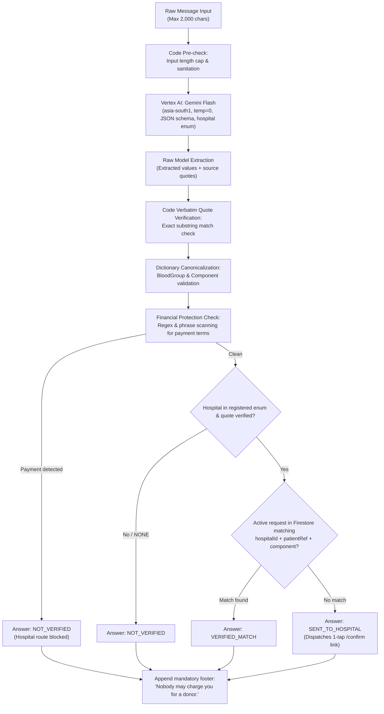

# U2U AI Pipeline Design: Gemini Flash at the Request Desk

> **Status:** planned (Implementation planned for Milestone 4)

This document specifies the architecture, safety constraints, quote validation algorithm, and evaluation protocol for the Gemini Flash integration at the U2U Request Desk.

---

## 1. Design Philosophy: Strict Extraction, Code Authority

Forwarded WhatsApp blood requests are frequently noisy, ambiguous, outdated, or fraudulent. Generative AI is exceptionally well-suited for entity extraction across informal languages (English and Tamil), but **must never be granted decision authority in emergency medical coordination**.

At U2U, the boundary is absolute:
- **Gemini extracts:** Identifies entities and provides exact verbatim quotes from the input text.
- **Code validates:** Python code validates every quote character-by-character against raw text, drops hallucinations, searches registered hospital records, evaluates payment risks, and decides the final answer.
- **Gemini NEVER decides:** The AI model never sets a request status, never marks a match as valid, never evaluates donor eligibility, and never triggers an outbound phone call.

---

## 2. The Request Desk Pipeline



### Step 1: Code Guardrails & Input Caps
- The API accepts a maximum of 2,000 characters (`POST /desk/check`). Messages exceeding 2,000 characters are rejected at the gateway.

### Step 2: One Gemini Flash Call at Temperature 0
- Hosted on **Vertex AI (`asia-south1`)**.
- Invoked with `temperature: 0.0` for deterministic reproducibility.
- Governed by a strict JSON schema and a fixed enum of verified hospital identifiers registered in the system (plus `"NONE"`). The model is mathematically prevented from outputting unvetted hospital strings in the enum field.

### Step 3: Verbatim Quote Verification
For every extracted entity (hospital name, patient number, blood group, component, units needed), Gemini is required to return a `QuotedField`:
```ts
interface QuotedField<T> {
  value: T | null;
  quote: string | null;
  kept: boolean;
}
```
**The Code Rule:** The backend Python service inspects each `quote`. If `quote` is null, or if `quote` does **not** appear as an exact, case-sensitive substring within the original user input, the field is dropped:
```python
if field.quote and field.quote in raw_text:
    field.kept = True
else:
    field.value = None
    field.kept = False
```
This eliminates hallucinated patient IDs, fabricated unit quantities, and imagined hospital endorsements.

### Step 4: Dictionary Canonicalization
Extracted values are mapped to canonical system types:
- **Blood Group:** `'A+' | 'A-' | 'B+' | 'B-' | 'AB+' | 'AB-' | 'O+' | 'O-'`
- **Component:** `'WHOLE_BLOOD' | 'RED_CELLS' | 'PLATELETS_SDP' | 'PLATELETS_RDP' | 'PLASMA' | 'UNSPECIFIED'`

### Step 5: Financial Protection Check
Exploitation of vulnerable families by predatory blood brokers is a known threat [CITE SOURCE]. The backend scans raw text and extracted tokens against a comprehensive dictionary of remuneration keywords (English and Tamil: e.g., *"paid donor"*, *"remuneration"*, *"charges apply"*, *"money offered"*, *"urgent cash"*, *"பணம்"*):
- If payment wording is identified, the system **immediately blocks automated hospital alert generation**.
- Prevents commercial donor solicitations from masquerading as voluntary hospital requests.

### Step 6: Exactly Three Deterministic Answers
1. **`VERIFIED_MATCH`:** An active, verified request in Firestore matches the verified hospital ID, patient number, and component. Directs the user to the active progress screen.
2. **`SENT_TO_HOSPITAL`:** The message names a verified hospital and verified patient reference, but no active request exists yet. A secure single-use confirmation token is generated and sent to the hospital blood bank (`/confirm/:token`).
3. **`NOT_VERIFIED`:** Unrecognized hospital, failed quote checks, detected payment phrases, or missing required fields. User receives: *"Couldn't verify. Please call the hospital."*

### Step 7: Mandatory Protection Footer
Every Request Desk answer without exception concludes with the immutable sentence:
> **"Nobody may charge you for a donor."**

---

## 3. What Gemini Never Does

To protect patient safety and system integrity:
1. **Never sets request status:** Only authenticated hospital staff and deterministic state machines can create or modify `BloodRequest.status`.
2. **Never validates donor medical eligibility:** Only physical blood centre staff review hemoglobin, vitals, and health history upon donor arrival.
3. **Never initiates phone calls:** The Gemini pipeline has zero access to the outreach dialer or telephony queues.
4. **Never executes fuzzy hospital matching:** Hospital identification relies strictly on exact enum resolution confirmed by verbatim text quotes.

---

## 4. Graceful Fallback Behavior

In the event of:
- Vertex AI network timeout or 5xx outage
- Quota exhaustion or rate limiting
- Malformed JSON returned by the model

The system immediately fails safely to:
```json
{
  "answer": "NOT_VERIFIED",
  "message": "Couldn't verify. Please call the hospital.",
  "footer": "Nobody may charge you for a donor."
}
```
Under no circumstances does an AI failure block clinical hospital workflows or emit unvetted notifications.

---

## 5. How the Trace is Shown to Users

At the Request Desk (`/desk`), complete algorithmic transparency is rendered through the collapsible `TracePanel` titled **"How U2U checked this"**:

1. **One-Line Core Explainer:**
   > *"Gemini reads. Code checks every word. Only the hospital and blood centre decide."*
   Prominently placed at the top of the trace drawer to reinforce AI authority limits to all users and evaluators.

2. **Dual Decision Attribution:**
   - **Gemini Extraction:** Displayed as `"Gemini chose: {geminiChoice}"`.
   - **Deterministic Code Decision:** Displayed as `"Code decided: {codeDecision}"`.
   - **Mock Honesty:** Whenever running simulated handlers (where `geminiChoice` starts with `"Mock extractor"`), a high-contrast `"Mock"` tag is rendered so evaluators and judges never mistake demo simulation for live Gemini Flash.

3. **Verbatim Quote Highlighting in Input Text:**
   The user's original message is displayed with kept quotes highlighted in green (`<mark>` with `bg-[var(--success-tint)]`), demonstrating exactly which words grounded the extraction.

4. **Dropped Hallucination Strikethrough:**
   Any quote extracted by the model that does not match the original message character-for-character is displayed struck through with the explicit label:
   `"{quote}" — not found in the message`.

5. **Extracted Fields Matrix:**
   Each entity (Hospital Name, Patient Number, Blood Group, Component, Units Needed) is itemized showing both its canonical value and its source quote, tagged with `Kept` (green) or `Dropped` (red).

6. **Payment & Scam Protection Callout:**
   If remuneration keywords are identified (e.g., *"paid donor"*, *"conveyance cash"*, *"₹3,000"*), the detected phrases are flagged in a high-contrast alert box, explaining why the message was barred from hospital routing.

---

## 6. Evaluation & Continuous Testing (`/eval`)

The Request Desk pipeline is benchmarked against a curated, labelled evaluation suite stored in `backend/eval/`:

- **Test Set Composition:**
  - True positive emergency requests (English, Tamil, and Tanglish).
  - Unregistered hospital forwards and vague emergency forwards.
  - Commercial and paid donor solicitation scams.
  - Expired and outdated broadcast chains.
- **Zero-Tolerance Safety Rules:**
  - `paymentToHospital`: Must equal **0**. (Zero instances of commercial payment requests forwarded to hospital staff).
  - `wrongHospitalIds`: Must equal **0**. (Zero instances of attributing a message to an incorrect hospital).
- **Tracked Metrics (`GET /eval/latest`):**
  - Prompt version and timestamp.
  - Overall accuracy percentage ($\text{correct} / \text{total}$).
  - P95 response latency in milliseconds.
  - Itemized pass/fail trace rows visible to hackathon judges on `/eval`.
