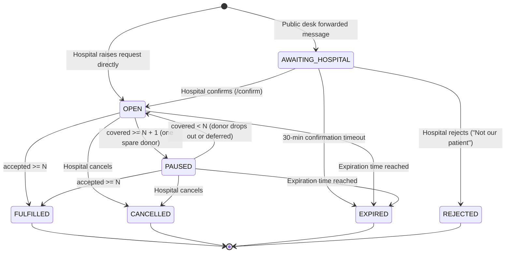
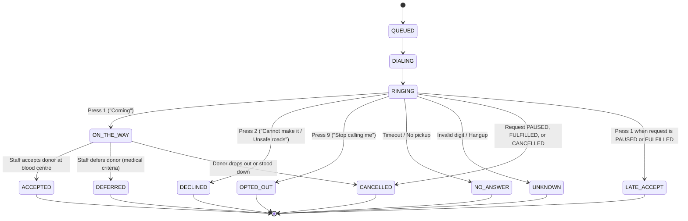

# U2U Architecture

> **Status:** planned (System design specification for implementation)

This document specifies the technical architecture, modular structure, state machines, persistence model, and reliability guarantees for U2U (Uyir2Uyir).

---

## 1. System Overview

U2U is structured as a **modular monolith** on the backend and a reactive single-page application on the frontend, designed for zero-lag emergency coordination.

- **Frontend:** React 19 + TypeScript (strict) + Vite deployed on **Firebase Hosting**. Reads real-time data directly from Cloud Firestore listeners (read-only) and dispatches state mutations exclusively via authenticated backend API calls.
- **Backend:** Python 3.12 **FastAPI modular monolith** deployed on **Google Cloud Run** (`asia-south1`). Encapsulates business logic, deterministic rule enforcement, outreach orchestration, and AI verification.
- **Persistence:** **Cloud Firestore** using dedicated databases per operational mode.
- **AI Service:** **Gemini Flash on Vertex AI** (`asia-south1`) invoked under strict JSON schemas with character-by-character quote verification in code.
- **Voice Outreach:** Telephony dispatch via Twilio (live allowlist) and an in-browser IVR simulator (demo mode), backed by cached Cloud Text-to-Speech audio in Tamil and English.

```mermaid
flowchart TD
    subgraph Clients["Frontend Clients (Firebase Hosting)"]
        H[Hospital Screen /hospital]
        C[Blood Centre Screen /centre]
        D[Request Desk /desk]
        S[Simulator Screen /sim]
        J[Donor Join /join]
    end

    subgraph API["Backend Modular Monolith (Cloud Run)"]
        GW["FastAPI Gateway"]
        AUTH["auth"]
        REQ["requests"]
        RULES["rules (N+1)"]
        MATCH["matching"]
        OUT["outreach"]
        SCREEN["screening"]
        DESK["desk"]
        AI["ai"]
        CLOCK["clock"]
    end

    subgraph GCP["Google Cloud Services"]
        FS[("Cloud Firestore\nu2u-demo / u2u-live")]
        VERTEX["Vertex AI (Gemini Flash)"]
        TTS["Cloud Text-to-Speech"]
        SCHED["Cloud Scheduler (1-min tick)"]
        SECMON["Secret Manager & Cloud Logging"]
    end

    subgraph Voice["Telephony"]
        TWILIO["Twilio Voice API"]
    end

    H -->|POST /requests| GW
    C -->|POST /calls/{id}/accept| GW
    D -->|POST /desk/check| GW
    S -->|POST /sim/calls/{id}/press| GW
    J -->|POST /donors/signup| GW

    Clients -.->|Read-only Listeners| FS

    GW --> AUTH
    GW --> REQ
    GW --> DESK
    GW --> SCREEN
    
    REQ --> RULES
    REQ --> MATCH
    MATCH --> OUT
    OUT --> TWILIO
    OUT --> TTS
    DESK --> AI
    AI --> VERTEX
    CLOCK --> REQ
    CLOCK --> OUT

    REQ --> FS
    SCREEN --> FS
    OUT --> FS
    AUTH --> SECMON
```

---

## 2. The Nine Backend Modules

The backend (`backend/app/`) is architected as an internal modular monolith where modules communicate via explicit Python interfaces rather than distributed network calls:

| Module | Purpose | Key Responsibilities |
|---|---|---|
| `core` | Shared primitives | Configuration (`AppConfig`), database clients, logging, exception definitions, and secret isolation. |
| `auth` | Identity & security | Firebase Auth JWT verification, role-based access control, custom claims (`role`, `hospitalId`, `centreId`, `env`). |
| `requests` | Request management | Request lifecycle (`BloodRequest`), status transitions, expiration checking, and hospital cancellation. |
| `rules` | Deterministic engine | Enforces the $N+1$ counting rule, pause conditions, reopen triggers, fulfillment transitions, and donor stand-down logic. |
| `matching` | Donor discovery | Donor pool filtering by blood group compatibility, geographic radius/area, and language preference into batches of 5. |
| `outreach` | Voice dispatching | Round orchestration, Twilio call dispatching, in-app simulator bridge, IVR keypad webhook handling, Cloud TTS caching. |
| `screening` | Centre staff portal | Arriving donor verification, medical eligibility sign-off (accept/defer), and deferral return-date scheduling. |
| `desk` | Public verification | Ingestion of forwarded WhatsApp messages, Gemini extraction orchestration, quote validation, and one-tap hospital notification. |
| `ai` | Model interface | Vertex AI Gemini Flash client, temperature 0 prompt execution, structured JSON schema validation, and payment phrase detection. |
| `clock` | Scheduled reconciliation | Cloud Scheduler 1-minute ticker handling round timeouts, expiration sweeps, and call reminders. |

### 2.1 Backend Layout

The physical codebase layout under `backend/` strictly reflects these modular boundaries:

```
backend/
├── app/
│   ├── main.py                  # App factory create_app(), CORS, /healthz, /config
│   ├── core/
│   │   ├── config.py            # pydantic-settings Settings, STORE selection, env validation
│   │   ├── mode_guard.py        # ModeGuard refusing DATA_MODE / FIRESTORE_DB mismatch
│   │   ├── models.py            # CamelModel base with to_camel alias generator
│   │   ├── entities.py          # Hospital, Centre, and Donor domain models
│   │   ├── store.py             # Store and TransactionStore protocols
│   │   ├── store_memory.py      # Thread-safe in-memory store for unit tests and local dev
│   │   ├── store_firestore.py   # Async transactional Firestore store
│   │   └── logging.py           # Structured JSON logger, phone redactor, 422 sanitizer
│   ├── auth/                    # Firebase Auth JWT, claims extraction, RBAC
│   ├── requests/                # Blood request models, counting rules, and transitions
│   ├── rules/                   # Deterministic blood compatibility and contact rules
│   ├── matching/                # Donor compatibility and 5-donor batching
│   ├── outreach/                # Twilio voice client, IVR simulator bridge, TTS
│   ├── screening/               # Donor triage: accept, defer, and return dates
│   ├── desk/                    # WhatsApp message check, quote verifier, confirm tokens
│   ├── ai/                      # Vertex AI Gemini Flash client (temperature 0)
│   ├── clock/                   # Cloud Scheduler 1-min reconciliation sweeps
│   └── admin/                   # Demo scenario runner and operational resets
├── scripts/
│   └── seed.py                  # Database seed script for hospitals, centres, donors, and config
├── tests/                       # Pytest test suites (domain, store, health, logging, mode guard)
├── Dockerfile                   # python:3.12-slim non-root Cloud Run container
├── pyproject.toml               # Poetry/pip project definition, ruff, and pytest configs
├── requirements.txt             # Pinned production dependencies
├── requirements-dev.txt         # Dev, test, and lint dependencies
├── Makefile                     # make dev, make test, make lint
└── .env.example                 # Placeholder environment settings
```

---

## 3. Data Modes & Persistence

U2U separates demonstration and live operational environments using separate Cloud Firestore databases to guarantee test data never contaminates clinical workflows:

| Property | `DATA_MODE=demo` | `DATA_MODE=live` |
|---|---|---|
| **Firestore Database** | `(default)` or `u2u-demo` | `u2u-live` |
| **Simulated Flag** | `isSimulated: true` on all records | `isSimulated: false` |
| **UI Banner** | Orange `"SIMULATED DATA"` banner fixed on every screen | None |
| **Voice Calls** | In-app simulator (`/sim`) + team allowlist phones | Live telephony dispatch |
| **Data Reset** | `POST /admin/reset` enabled | Endpoint disabled |
| **Scenario Runner** | `POST /admin/scenario/{id}/run` active | Disabled |
| **Desk Confirm Link** | `demoConfirmToken` returned in API response for testing | Sent securely to hospital blood bank |

---

## 4. State Machines

The deterministic state transitions for both requests and outreach calls are implemented as pure functions in [`backend/app/requests/transitions.py`](../backend/app/requests/transitions.py), with counting and pause/reopen/fulfillment rules governed by [`backend/app/requests/counting.py`](../backend/app/requests/counting.py).

### 4.1 Request State Machine

A blood request transitions deterministically based on hospital actions, time expiration, and the $N+1$ donor rule:



### 4.2 Call State Machine

Each outbound donor outreach call follows an explicit state machine triggered by IVR keypad inputs, staff physical arrivals, and request standing-down rules:



---

## 5. Firestore Collection Structure

```
/requests/{requestId}
  ├── id: string
  ├── hospitalId: string
  ├── hospitalName: string
  ├── centreId: string
  ├── centreName: string
  ├── bloodGroup: BloodGroup ('A+'|'A-'|'B+'|'B-'|'AB+'|'AB-'|'O+'|'O-')
  ├── component: Component ('WHOLE_BLOOD'|'RED_CELLS'|'PLATELETS_SDP'|'PLATELETS_RDP'|'PLASMA'|'UNSPECIFIED')
  ├── unitsNeeded: number (N)
  ├── status: RequestStatus
  ├── accepted: number
  ├── onTheWay: number
  ├── round: number
  ├── createdAt: ISO8601 string
  ├── updatedAt: ISO8601 string
  ├── expiresAt: ISO8601 string
  ├── isSimulated: boolean
  ├── patientRef?: string (RESTRICTED: accessible only to authorized hospital/centre staff)
  │
  ├── /calls/{callId} (Subcollection)
  │     ├── id: string
  │     ├── requestId: string
  │     ├── donorAlias: string (e.g. "Donor A7")
  │     ├── bloodGroup: BloodGroup
  │     ├── lang: 'en'|'ta'
  │     ├── state: CallState
  │     ├── round: number
  │     ├── etaMinutes: number | null
  │     ├── distanceKm: number
  │     └── updatedAt: ISO8601 string
  │
  └── /events/{eventId} (Subcollection)
        ├── id: string
        ├── requestId: string
        ├── at: ISO8601 string
        ├── kind: string ('CALL_PLACED'|'DONOR_COMMITTED'|'PAUSED'|'REOPENED'|'FULFILLED'|'DEFERRED')
        └── text: string

/donors/{donorId}
  ├── id: string
  ├── alias: string ("Donor A7")
  ├── bloodGroup: BloodGroup
  ├── area: string
  ├── phoneHash: string (SHA-256 with salt)
  ├── phoneMasked: string ("+91 ••••• ••123")
  ├── lang: 'en'|'ta'
  ├── consentUrgent: boolean
  ├── consentHistory: boolean
  ├── adult: boolean
  ├── active: boolean
  ├── lastDonationDate: ISO8601 string | null
  └── isSimulated: boolean

/hospitals/{hospitalId}
  ├── id: string
  ├── name: string
  ├── centreId: string
  ├── area: string
  └── active: boolean

/centres/{centreId}
  ├── id: string
  ├── name: string
  ├── area: string
  └── active: boolean
```

### 5.1 Data Model Mapping & Storage Implementations

| Entity / Collection | Firestore Path | Model Class | Source File | Storage Implementation |
|---|---|---|---|---|
| **Blood Request** | `/requests/{id}` | `BloodRequest` | [`backend/app/requests/models.py`](../backend/app/requests/models.py) | [`backend/app/core/store_memory.py`](../backend/app/core/store_memory.py) / [`backend/app/core/store_firestore.py`](../backend/app/core/store_firestore.py) |
| **Outbound Call** | `/requests/{id}/calls/{callId}` | `Call` | [`backend/app/requests/models.py`](../backend/app/requests/models.py) | [`backend/app/core/store_memory.py`](../backend/app/core/store_memory.py) / [`backend/app/core/store_firestore.py`](../backend/app/core/store_firestore.py) |
| **Timeline Event** | `/requests/{id}/events/{id}` | `TimelineEvent` | [`backend/app/requests/models.py`](../backend/app/requests/models.py) | [`backend/app/core/store_memory.py`](../backend/app/core/store_memory.py) / [`backend/app/core/store_firestore.py`](../backend/app/core/store_firestore.py) |
| **Hospital** | `/hospitals/{id}` | `Hospital` | [`backend/app/core/entities.py`](../backend/app/core/entities.py) | Seeded by [`backend/scripts/seed.py`](../backend/scripts/seed.py) |
| **Blood Centre** | `/centres/{id}` | `Centre` | [`backend/app/core/entities.py`](../backend/app/core/entities.py) | Seeded by [`backend/scripts/seed.py`](../backend/scripts/seed.py) |
| **Donor Profile** | `/donors/{id}` | `Donor` | [`backend/app/core/entities.py`](../backend/app/core/entities.py) | Seeded by [`backend/scripts/seed.py`](../backend/scripts/seed.py) |
| **App Config** | `/config/app` | `dict[str, Any]` | `dict` / `AppConfig` | Initialized by [`backend/scripts/seed.py`](../backend/scripts/seed.py) |
| **Security Rules** | Firestore Security Rules | — | [`infra/firestore.demo.rules`](../infra/firestore.demo.rules) | Enforces read-only demo access, deny-all on PII |
| **Indexes** | Composite & Collection Group | — | [`infra/firestore.indexes.json`](../infra/firestore.indexes.json) | Indexes for `hospitalId+createdAt`, `centreId+createdAt`, and `calls.state` |

---

## 6. Reliability Rules

1. **Deterministic Counting Authority:**
   Outreach rounds, pause triggers, and fulfillment closures are driven exclusively by Python backend code in `backend/app/rules/`. Neither the frontend client nor the AI model has authority to transition request or call states.
2. **Cloud Scheduler Re-synchronization:**
   The 1-minute Cloud Scheduler tick is idempotent. In the event of network disruption or worker restarts, the scheduler evaluates all active requests against current timestamp deadlines and transitions timed-out requests to `EXPIRED`.
3. **Graceful AI Degradation:**
   If Vertex AI is unreachable or encounters quota limits during a Request Desk submission, the pipeline fails safely to `NOT_VERIFIED` with the message: *"Couldn't verify. Please call the hospital."* It never invents an extraction or creates an unverified hospital alert.
4. **Rate Limiting & Donor Protection:**
   The matching engine contacts donors in strict batches of 5. Once a request reaches `PAUSED` or `FULFILLED`, active dialers immediately stand down, and late keypresses are acknowledged with gratitude (`LATE_ACCEPT`) to avoid donor fatigue.
5. **No Secret Ingestion in Client Bundles:**
   No service account keys, Twilio auth tokens, or Vertex AI service tokens exist in the frontend application. All external integrations are isolated in backend Cloud Run micro-services accessing Secret Manager.
