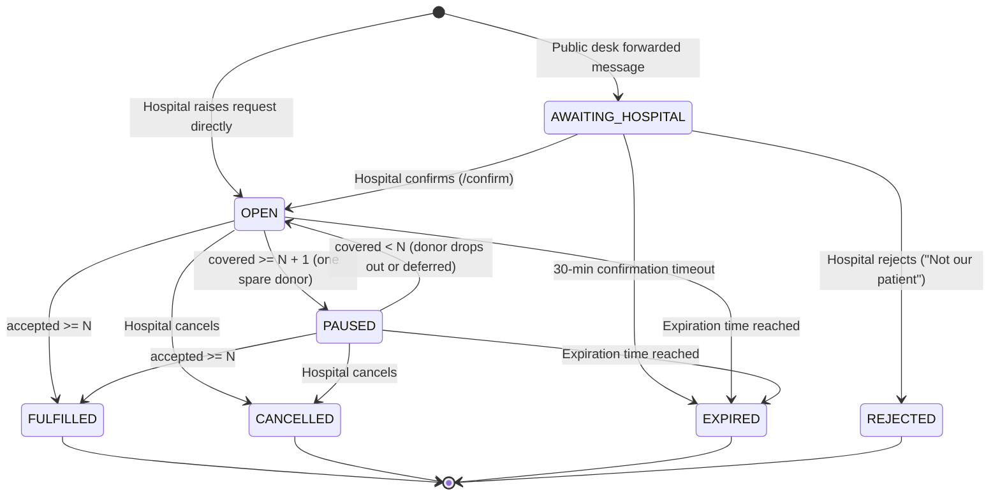
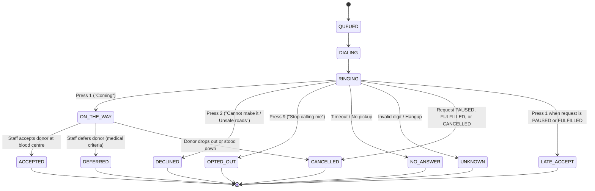
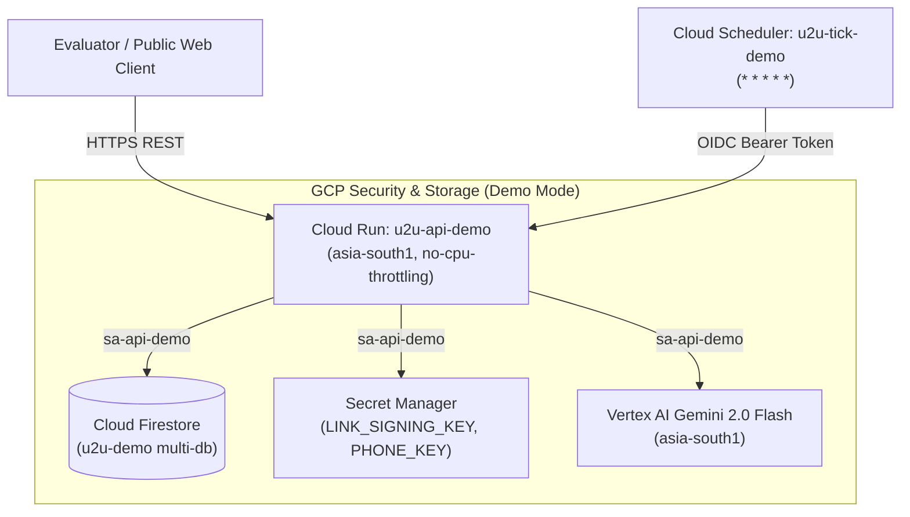
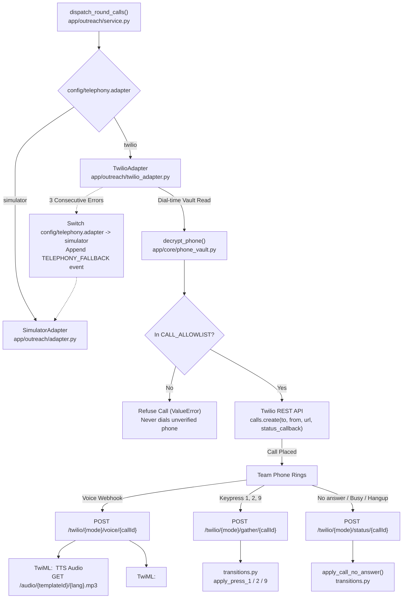

# U2U Architecture

> **Status:** built (System architecture and modular monolith implemented and deployed)

This document specifies the technical architecture, modular structure, state machines, persistence model, and reliability guarantees for U2U (Uyir2Uyir).

---

## 1. System Overview

U2U is structured as a **modular monolith** on the backend and a reactive single-page application on the frontend, designed for zero-lag emergency coordination.

- **Frontend:** React 19 + TypeScript (strict) + Vite deployed on **Firebase Hosting**. Reads real-time data directly from Cloud Firestore listeners (read-only) and dispatches state mutations exclusively via authenticated backend API calls.
- **Backend:** Python 3.12 **FastAPI modular monolith** deployed on **Google Cloud Run** (`asia-south1`). Encapsulates business logic, deterministic rule enforcement, outreach orchestration, and AI verification.
- **Persistence:** **Cloud Firestore** using dedicated databases per operational mode.
- **AI Service:** **Gemini Flash on Vertex AI** (`asia-south1`) invoked under strict JSON schemas with character-by-character quote verification in code.
- **Voice Outreach:** Telephony dispatch via Twilio (live allowlist) and an in-browser IVR simulator (demo mode), backed by cached Cloud Text-to-Speech audio in Tamil and English.

```mermaid
flowchart TD
    subgraph Clients["Frontend Clients (Firebase Hosting)"]
        H[Hospital Screen /hospital]
        C[Blood Centre Screen /centre]
        D[Request Desk /desk]
        S[Simulator Screen /sim]
        J[Donor Join /join]
    end

    subgraph API["Backend Modular Monolith (Cloud Run)"]
        GW["FastAPI Gateway"]
        AUTH["auth"]
        REQ["requests"]
        RULES["rules (N+1)"]
        MATCH["matching"]
        OUT["outreach"]
        SCREEN["screening"]
        DESK["desk"]
        AI["ai"]
        CLOCK["clock"]
    end

    subgraph GCP["Google Cloud Services"]
        FS[("Cloud Firestore\nu2u-demo / u2u-live")]
        VERTEX["Vertex AI (Gemini Flash)"]
        TTS["Cloud Text-to-Speech"]
        SCHED["Cloud Scheduler (1-min tick)"]
        SECMON["Secret Manager & Cloud Logging"]
    end

    subgraph Voice["Telephony"]
        TWILIO["Twilio Voice API"]
    end

    H -->|POST /requests| GW
    C -->|POST /calls/{id}/accept| GW
    D -->|POST /desk/check| GW
    S -->|POST /sim/calls/{id}/press| GW
    J -->|POST /donors/signup| GW

    Clients -.->|Read-only Listeners| FS

    GW --> AUTH
    GW --> REQ
    GW --> DESK
    GW --> SCREEN
    
    REQ --> RULES
    REQ --> MATCH
    MATCH --> OUT
    OUT --> TWILIO
    OUT --> TTS
    DESK --> AI
    AI --> VERTEX
    CLOCK --> REQ
    CLOCK --> OUT

    REQ --> FS
    SCREEN --> FS
    OUT --> FS
    AUTH --> SECMON
```

---

## 2. The Nine Backend Modules

The backend (`backend/app/`) is architected as an internal modular monolith where modules communicate via explicit Python interfaces rather than distributed network calls:

| Module | Purpose | Key Responsibilities |
|---|---|---|
| `core` | Shared primitives | Configuration (`AppConfig`), database clients, logging, exception definitions, and secret isolation. |
| `auth` | Identity & security | Firebase Auth JWT verification, role-based access control, custom claims (`role`, `hospitalId`, `centreId`, `env`). |
| `requests` | Request management | Request lifecycle (`BloodRequest`), status transitions, expiration checking, and hospital cancellation. |
| `rules` | Deterministic engine | Enforces the $N+1$ counting rule, pause conditions, reopen triggers, fulfillment transitions, and donor stand-down logic. |
| `matching` | Donor discovery | Donor pool filtering by blood group compatibility, geographic radius/area, and language preference into batches of 5. |
| `outreach` | Voice dispatching | Round orchestration, Twilio call dispatching, in-app simulator bridge, IVR keypad webhook handling, Cloud TTS caching. |
| `screening` | Centre staff portal | Arriving donor verification, medical eligibility sign-off (accept/defer), and deferral return-date scheduling. |
| `desk` | Public verification | Ingestion of forwarded WhatsApp messages, Gemini extraction orchestration, quote validation, and one-tap hospital notification. |
| `ai` | Model interface | Vertex AI Gemini Flash client, temperature 0 prompt execution, structured JSON schema validation, and payment phrase detection. |
| `clock` | Scheduled reconciliation | Cloud Scheduler 1-minute ticker handling round timeouts, expiration sweeps, and call reminders. |

### 2.1 Backend Layout

The physical codebase layout under `backend/` strictly reflects these modular boundaries:

```
backend/
├── app/
│   ├── main.py                  # App factory create_app(), CORS, /healthz, /config
│   ├── core/
│   │   ├── config.py            # pydantic-settings Settings, STORE selection, env validation, PHONE_KEY
│   │   ├── mode_guard.py        # ModeGuard refusing DATA_MODE / FIRESTORE_DB mismatch
│   │   ├── models.py            # CamelModel base with to_camel alias generator
│   │   ├── entities.py          # Hospital, Centre, and Donor domain models
│   │   ├── phone_vault.py       # AES-256-GCM phone encryption, HMAC blind hash, last 4
│   │   ├── audit.py             # Append-only audit logger for sensitive actions
│   │   ├── store.py             # Store and TransactionStore protocols
│   │   ├── store_memory.py      # Thread-safe in-memory store for unit tests and local dev
│   │   ├── store_firestore.py   # Async transactional Firestore store
│   │   └── logging.py           # Structured JSON logger, phone redactor, 422 sanitizer
│   ├── auth/                    # Firebase Auth ID tokens, custom claims, RBAC, POST /auth/demo-role
│   │   ├── constants.py         # Fixed demo story hospital and centre IDs
│   │   ├── dependencies.py      # get_actor, require_hospital_actor, require_staff_actor, require_demo_actor
│   │   └── router.py            # POST /auth/demo-role (sets custom claims on anonymous accounts)
│   ├── donors/                  # Donor onboarding, input validation, and consent logging
│   │   └── router.py            # POST /donors/signup (validates Indian mobile, records vault & consents)
│   ├── requests/                # Blood request models, counting rules, transitions, GET /{id} isolation
│   ├── rules/                   # Deterministic blood compatibility and contact rules
│   ├── matching/                # Donor compatibility and 5-donor batching
│   ├── outreach/                # Twilio voice client, IVR simulator bridge, TTS, Press 9 consent withdrawal
│   ├── screening/               # Donor triage: accept, defer, and return dates
│   ├── desk/                    # WhatsApp message check, quote verifier, confirm tokens
│   ├── ai/                      # Vertex AI Gemini Flash client (temperature 0)
│   ├── clock/                   # Cloud Scheduler 1-min reconciliation sweeps
│   └── admin/                   # Demo scenario runner, clock advancement, and resets
├── scripts/
│   └── seed.py                  # Database seed script for hospitals, centres, donors, and config
├── tests/                       # Pytest test suites (domain, store, auth, privacy, desk, admin, metrics)
├── Dockerfile                   # python:3.12-slim non-root Cloud Run container
├── pyproject.toml               # Poetry/pip project definition, ruff, and pytest configs
├── requirements.txt             # Pinned production dependencies
├── requirements-dev.txt         # Dev, test, and lint dependencies
├── Makefile                     # make dev, make test, make lint
└── .env.example                 # Placeholder environment settings
```

---


## 3. Data Modes & Persistence

U2U separates demonstration and live operational environments using separate Cloud Firestore databases to guarantee test data never contaminates clinical workflows:

| Property | `DATA_MODE=demo` | `DATA_MODE=live` |
|---|---|---|
| **Firestore Database** | `(default)` or `u2u-demo` | `u2u-live` |
| **Simulated Flag** | `isSimulated: true` on all records | `isSimulated: false` |
| **UI Banner** | Orange `"SIMULATED DATA"` banner fixed on every screen | None |
| **Voice Calls** | In-app simulator (`/sim`) + team allowlist phones | Live telephony dispatch |
| **Data Reset** | `POST /admin/reset` enabled | Endpoint disabled |
| **Scenario Runner** | `POST /admin/scenario/{id}/run` active | Disabled |
| **Desk Confirm Link** | `demoConfirmToken` returned in API response for testing | Sent securely to hospital blood bank |

---

## 4. State Machines

The deterministic state transitions for both requests and outreach calls are implemented as pure functions in [`backend/app/requests/transitions.py`](../backend/app/requests/transitions.py), with counting and pause/reopen/fulfillment rules governed by [`backend/app/requests/counting.py`](../backend/app/requests/counting.py).

### 4.1 Request State Machine

A blood request transitions deterministically based on hospital actions, time expiration, and the $N+1$ donor rule:



### 4.2 Call State Machine

Each outbound donor outreach call follows an explicit state machine triggered by IVR keypad inputs, staff physical arrivals, and request standing-down rules:



---

## 5. Firestore Collection Structure

```
/requests/{requestId}
  ├── id: string
  ├── hospitalId: string
  ├── hospitalName: string
  ├── centreId: string
  ├── centreName: string
  ├── bloodGroup: BloodGroup ('A+'|'A-'|'B+'|'B-'|'AB+'|'AB-'|'O+'|'O-')
  ├── component: Component ('WHOLE_BLOOD'|'RED_CELLS'|'PLATELETS_SDP'|'PLATELETS_RDP'|'PLASMA'|'UNSPECIFIED')
  ├── unitsNeeded: number (N)
  ├── status: RequestStatus
  ├── accepted: number
  ├── onTheWay: number
  ├── round: number
  ├── createdAt: ISO8601 string
  ├── updatedAt: ISO8601 string
  ├── expiresAt: ISO8601 string
  ├── isSimulated: boolean
  ├── patientRef?: string (RESTRICTED: accessible only to authorized hospital/centre staff)
  │
  ├── /calls/{callId} (Subcollection)
  │     ├── id: string
  │     ├── requestId: string
  │     ├── donorAlias: string (e.g. "Donor A7")
  │     ├── bloodGroup: BloodGroup
  │     ├── lang: 'en'|'ta'
  │     ├── state: CallState
  │     ├── round: number
  │     ├── etaMinutes: number | null
  │     ├── distanceKm: number
  │     └── updatedAt: ISO8601 string
  │
  └── /events/{eventId} (Subcollection)
        ├── id: string
        ├── requestId: string
        ├── at: ISO8601 string
        ├── kind: string ('CALL_PLACED'|'DONOR_COMMITTED'|'PAUSED'|'REOPENED'|'FULFILLED'|'DEFERRED')
        └── text: string

/donors/{donorId}
  ├── id: string
  ├── alias: string ("Donor A7")
  ├── bloodGroup: BloodGroup
  ├── area: string
  ├── phoneHash: string (SHA-256 with salt)
  ├── phoneMasked: string ("+91 ••••• ••123")
  ├── lang: 'en'|'ta'
  ├── consentUrgent: boolean
  ├── consentHistory: boolean
  ├── adult: boolean
  ├── active: boolean
  ├── lastDonationDate: ISO8601 string | null
  └── isSimulated: boolean

/hospitals/{hospitalId}
  ├── id: string
  ├── name: string
  ├── centreId: string
  ├── area: string
  └── active: boolean

/centres/{centreId}
  ├── id: string
  ├── name: string
  ├── area: string
  └── active: boolean

/donorContacts/{donorId}
  ├── donorId: string
  ├── encryptedPhone: string (AES-256-GCM ciphertext)
  ├── phoneHash: string (blind HMAC-SHA256 lookup hash)
  ├── last4: string (last 4 digits for masked display)
  └── createdAt: ISO8601 string

/consents/{donorId}/events/{eventId}
  ├── id: string
  ├── donorId: string
  ├── purpose: 'urgent_contact' | 'donation_history'
  ├── granted: boolean
  ├── action?: 'WITHDRAW'
  ├── noticeVersion: 'v1'
  ├── language: 'en' | 'ta'
  ├── channel: 'web' | 'ivr'
  └── at: ISO8601 string

/audit/{auditId}
  ├── id: string
  ├── actorUid: string
  ├── role: string
  ├── mode: 'demo' | 'live'
  ├── action: 'create' | 'cancel' | 'accept' | 'defer' | 'confirm' | 'opt-out'
  ├── targetId: string
  ├── beforeStatus: string | null
  ├── afterStatus: string | null
  └── at: ISO8601 string
```

### 5.1 Data Model Mapping & Storage Implementations

| Entity / Collection | Firestore Path | Model Class | Source File | Storage Implementation |
|---|---|---|---|---|
| **Blood Request** | `/requests/{id}` | `BloodRequest` | [`backend/app/requests/models.py`](../backend/app/requests/models.py) | [`backend/app/core/store_memory.py`](../backend/app/core/store_memory.py) / [`backend/app/core/store_firestore.py`](../backend/app/core/store_firestore.py) |
| **Outbound Call** | `/requests/{id}/calls/{callId}` | `Call` | [`backend/app/requests/models.py`](../backend/app/requests/models.py) | [`backend/app/core/store_memory.py`](../backend/app/core/store_memory.py) / [`backend/app/core/store_firestore.py`](../backend/app/core/store_firestore.py) |
| **Timeline Event** | `/requests/{id}/events/{id}` | `TimelineEvent` | [`backend/app/requests/models.py`](../backend/app/requests/models.py) | [`backend/app/core/store_memory.py`](../backend/app/core/store_memory.py) / [`backend/app/core/store_firestore.py`](../backend/app/core/store_firestore.py) |
| **Hospital** | `/hospitals/{id}` | `Hospital` | [`backend/app/core/entities.py`](../backend/app/core/entities.py) | Seeded by [`backend/scripts/seed.py`](../backend/scripts/seed.py) |
| **Blood Centre** | `/centres/{id}` | `Centre` | [`backend/app/core/entities.py`](../backend/app/core/entities.py) | Seeded by [`backend/scripts/seed.py`](../backend/scripts/seed.py) |
| **Donor Profile** | `/donors/{id}` | `Donor` | [`backend/app/core/entities.py`](../backend/app/core/entities.py) | Seeded by [`backend/scripts/seed.py`](../backend/scripts/seed.py) |
| **Phone Vault** | `/donorContacts/{id}` | `dict[str, Any]` | [`backend/app/core/phone_vault.py`](../backend/app/core/phone_vault.py) | [`backend/app/core/store_memory.py`](../backend/app/core/store_memory.py) / [`backend/app/core/store_firestore.py`](../backend/app/core/store_firestore.py) |
| **Consent Ledger** | `/consents/{donorId}/events/{id}` | `dict[str, Any]` | [`backend/app/donors/router.py`](../backend/app/donors/router.py) | [`backend/app/core/store_memory.py`](../backend/app/core/store_memory.py) / [`backend/app/core/store_firestore.py`](../backend/app/core/store_firestore.py) |
| **Audit Ledger** | `/audit/{id}` | `AuditEntry` | [`backend/app/core/audit.py`](../backend/app/core/audit.py) | [`backend/app/core/store_memory.py`](../backend/app/core/store_memory.py) / [`backend/app/core/store_firestore.py`](../backend/app/core/store_firestore.py) |
| **App Config** | `/config/app` | `dict[str, Any]` | `dict` / `AppConfig` | Initialized by [`backend/scripts/seed.py`](../backend/scripts/seed.py) |
| **Security Rules** | Firestore Security Rules | — | [`infra/firestore.demo.rules`](../infra/firestore.demo.rules) | Enforces read-only demo access, deny-all on PII |
| **Indexes** | Composite & Collection Group | — | [`infra/firestore.indexes.json`](../infra/firestore.indexes.json) | Indexes for `hospitalId+createdAt`, `centreId+createdAt`, and `calls.state` |

---


## 6. Reliability Rules

1. **Deterministic Counting Authority:**
   Outreach rounds, pause triggers ($N+1$), and fulfillment closures are driven exclusively by Python backend code in [`backend/app/requests/counting.py`](../backend/app/requests/counting.py) and [`backend/app/requests/transitions.py`](../backend/app/requests/transitions.py). Neither the frontend client nor the AI model has authority to transition request or call states.
2. **Cloud Scheduler Lease Lock & Re-synchronization:**
   The 1-minute Cloud Scheduler tick in [`backend/app/clock/router.py`](../backend/app/clock/router.py) takes a 50-second distributed lease in `locks/tick`. If a concurrent worker holds the lease, subsequent ticks return 200 immediately without redundant execution. Each round progression is strictly guarded by `"status is OPEN, round matches"`.
3. **Transactional Dispatch with Compare-and-Set:**
   Outreach calls in [`backend/app/outreach/service.py`](../backend/app/outreach/service.py) are staged in state `QUEUED` within a database transaction. Actual telephony or simulation dispatch happens strictly *after* transaction commit via compare-and-set (verifying state is still `QUEUED` before flipping to `DIALING` and triggering `TelephonyAdapter.place_call`).
4. **Safety Caps & Simulated Data Isolation:**
   Outreach enforces `REQUEST_CALL_CAP` (max 15 calls per blood request) and `DAILY_CALL_CAP` (max 30 outbound calls/day) in [`backend/app/outreach/service.py`](../backend/app/outreach/service.py). In `DATA_MODE=live`, calls to simulated donors are strictly refused.
5. **Deterministic Donor Matching:**
   Donor selection in [`backend/app/matching/service.py`](../backend/app/matching/service.py) applies clinical compatibility ([`backend/app/rules/compatibility.py`](../backend/app/rules/compatibility.py)), 90-day donation interval spacing ([`backend/app/rules/contact.py`](../backend/app/rules/contact.py)), urgent contact consent, and deterministic ordering (distance ascending $\to$ longest since last contacted $\to$ donor ID). Zero randomness.
6. **Graceful AI Degradation:**
   If Vertex AI is unreachable or encounters quota limits during a Request Desk submission, the pipeline fails safely to `NOT_VERIFIED` with the message: *"Couldn't verify. Please call the hospital."* It never invents an extraction or creates an unverified hospital alert.
7. **No Secret Ingestion in Client Bundles:**
   No service account keys, Twilio auth tokens, or Vertex AI service tokens exist in the frontend application. All external integrations are isolated in backend Cloud Run micro-services accessing Secret Manager.

---

## 7. Cloud Run & Infrastructure Deployment

The U2U backend deploys to **Google Cloud Run** in `asia-south1` as a containerized FastAPI application with Firestore, Vertex AI, Secret Manager, and Cloud Scheduler integrations.



### 7.1 Cloud Run Configuration Details

- **Service Name:** `u2u-api-demo` (Region: `asia-south1`)
- **Container Build:** Multi-stage container based on [`backend/Dockerfile`](../backend/Dockerfile) with non-root runtime (`appuser`) and Uvicorn proxy headers enabled.
- **`--allow-unauthenticated`:** Allows browser clients, Twilio webhooks, and public audio endpoints to reach the service. Application-layer security (Firebase ID tokens, HMAC link signatures, Twilio request signatures, and OIDC tokens) enforces authorization on every route.
- **`--no-cpu-throttling`:** Critical flag that keeps CPU allocated between requests, allowing background tasks (such as [`backend/app/clock/story.py`](../backend/app/clock/story.py) and delayed outreach dispatch) to execute continuously.
- **`--env-vars-file infra/env.demo.yaml`:** Passes complex environment variables without comma splitting issues inherent to `--set-env-vars`, safely maintaining `ALLOWED_ORIGINS` and `CALL_ALLOWLIST`.
- **`--set-secrets`:** Mounts `LINK_SIGNING_KEY`, `PHONE_KEY`, and `INTERNAL_TOKEN` directly from Google Secret Manager.

### 7.2 Service Accounts & Least Privilege IAM

| Service Account | Role Bindings | Purpose |
|---|---|---|
| `sa-api-demo` | `roles/datastore.user` | Read/write access to Firestore (`u2u-demo` database) |
| `sa-api-demo` | `roles/aiplatform.user` | Vertex AI Gemini Flash 2.0 extraction calls |
| `sa-api-demo` | `roles/logging.logWriter` | Structured application and audit logs |
| `sa-api-demo` | `roles/firebaseauth.admin` | Sets demo role custom claims via `firebase-admin` on anonymous accounts |
| `sa-api-demo` | `roles/secretmanager.secretAccessor` | Access strictly scoped to `LINK_SIGNING_KEY`, `PHONE_KEY`, and `INTERNAL_TOKEN` |
| `sa-scheduler` | `roles/run.invoker` | Permission to invoke Cloud Run service endpoint `/internal/tick` |
| `{PROJECT_NUMBER}-compute@developer.gserviceaccount.com` | `roles/run.builder` | Cloud Build authorization for `gcloud run deploy --source` builds |

### 7.3 Cloud Scheduler 1-Minute Tick via Google OIDC

Cloud Scheduler executes an automated HTTP POST request every minute (`* * * * *`) against `/internal/tick`:
- **Auth Header:** `Authorization: Bearer <Google-signed OIDC ID Token>`
- **Token Audience:** Service URL (`https://u2u-api-demo-...-as.a.run.app`)
- **Token Subject/Email:** `sa-scheduler@${PROJECT_ID}.iam.gserviceaccount.com`
- **Application Validation:** [`backend/app/clock/router.py`](../backend/app/clock/router.py) validates the token using `google.oauth2.id_token.verify_oauth2_token()`, verifying that the token was signed by Google, the audience matches the service URL, and the email matches the authorized scheduler service account.

### 7.4 Deployment Scripts & Lifecycle

- [`infra/deploy_firestore_rules.sh`](../infra/deploy_firestore_rules.sh): Deploys [`infra/firestore.demo.rules`](../infra/firestore.demo.rules) and [`infra/firestore.indexes.json`](../infra/firestore.indexes.json) to the `u2u-demo` named database via Firebase CLI.
- [`infra/deploy_backend_demo.sh`](../infra/deploy_backend_demo.sh): Idempotent bash script provisioning service accounts, secrets, Cloud Build builder role, Cloud Run service, and Cloud Scheduler ticker.
- [`infra/smoke_backend.sh`](../infra/smoke_backend.sh): Post-deployment smoke script that verifies `/healthz`, `/config`, triggers the 5-step scenario story, polls until the request is `FULFILLED`, and asserts timeline `/metrics`.

---

## 8. Telephony & Voice Outreach Architecture

U2U implements a dual telephony dispatch architecture supporting simulated in-browser demonstration and real outbound carrier calls to allowlisted team numbers:



### 8.1 Component File Paths & Responsibilities

| Component | File Path | Responsibilities |
|---|---|---|
| **Telephony Protocol & Simulator** | [`backend/app/outreach/adapter.py`](../backend/app/outreach/adapter.py) | Defines `TelephonyAdapter` protocol and `SimulatorAdapter` marking calls `RINGING` for UI simulator. |
| **Twilio Adapter** | [`backend/app/outreach/twilio_adapter.py`](../backend/app/outreach/twilio_adapter.py) | Places outbound calls via Twilio Voice API (`timeout=25`, `time_limit=90`, `record=False`). Decrypts phone from vault at dial time and enforces `CALL_ALLOWLIST`. Tracks consecutive errors and switches to simulator after 3 failures. |
| **Twilio Webhooks Router** | [`backend/app/outreach/twilio_router.py`](../backend/app/outreach/twilio_router.py) | Handles `/twilio/{mode}/voice/{callId}`, `/twilio/{mode}/gather/{callId}`, and `/twilio/{mode}/status/{callId}`. Validates `X-Twilio-Signature` using `twilio.request_validator.RequestValidator` against `PUBLIC_BASE_URL`. Enforces `mode == DATA_MODE` (403 on mismatch) and deduplicates events on `webhookEvents/{CallSid}_{event}` using create-only. |
| **Cloud Text-to-Speech** | [`backend/app/ai/tts.py`](../backend/app/ai/tts.py) | Synthesizes bilingual audio scripts (`ta-IN-Standard-A` for Tamil, `en-IN-Standard-A` for English) once per template, language, and weather flag. Caches MP3 in memory and `/tmp`, served via `GET /audio/{templateId}/{lang}.mp3`. |
| **Outreach Orchestrator** | [`backend/app/outreach/service.py`](../backend/app/outreach/service.py) | Dispatches round calls, dynamically chooses telephony adapter via `get_telephony_adapter()`, and registers audio templates. |
| **Admin Controls** | [`backend/app/admin/router.py`](../backend/app/admin/router.py) | Exposes `GET /admin/settings/telephony` and `POST /admin/settings/telephony` for dynamic adapter inspection and toggling. |

---

## 9. How to Verify

Judges and evaluators can independently verify the implementation, test coverage, and live cloud deployment using the following commands:

### 9.1 Frontend Test Suite & Accessibility Audit
Runs 115 unit, component, and accessibility tests across 19 test files with Vitest and `axe-core`:
```bash
cd frontend
npm run lint
npm test
npm run build
```

### 9.2 Backend Test Suite & State Machine Invariants
Runs 125 tests (plus 1 optional emulator test skipped when emulator host is unset) across 17 test suites, including 200 Hypothesis stateful property runs:
```bash
cd backend
# On Windows PowerShell:
.\run.ps1 lint
.\run.ps1 test

# On macOS/Linux:
make lint
make test
```

### 9.3 Request Desk AI Benchmark (Gemini on Vertex AI)
Runs the labelled evaluation suite across 30 test cases in `backend/eval/` (verifying exact-quote verification and financial remuneration blocking):
```bash
cd backend
python eval/run_eval.py
```

### 9.4 Cloud Run Live Deployment Smoke Test
Verifies health, configuration, scenario story replay, and metrics on the deployed Cloud Run service:
```bash
# On Linux / macOS / Git Bash:
./infra/smoke_backend.sh https://u2u-api-demo-77691642972.asia-south1.run.app

# On Windows PowerShell:
.\infra\smoke_backend.ps1 https://u2u-api-demo-77691642972.asia-south1.run.app
```

### 9.5 Live Deployment Endpoints
- **Web Application (Firebase Hosting):** [https://uyir2uyir-53929.web.app](https://uyir2uyir-53929.web.app)
- **Backend API (Google Cloud Run):** [https://u2u-api-demo-77691642972.asia-south1.run.app](https://u2u-api-demo-77691642972.asia-south1.run.app)


