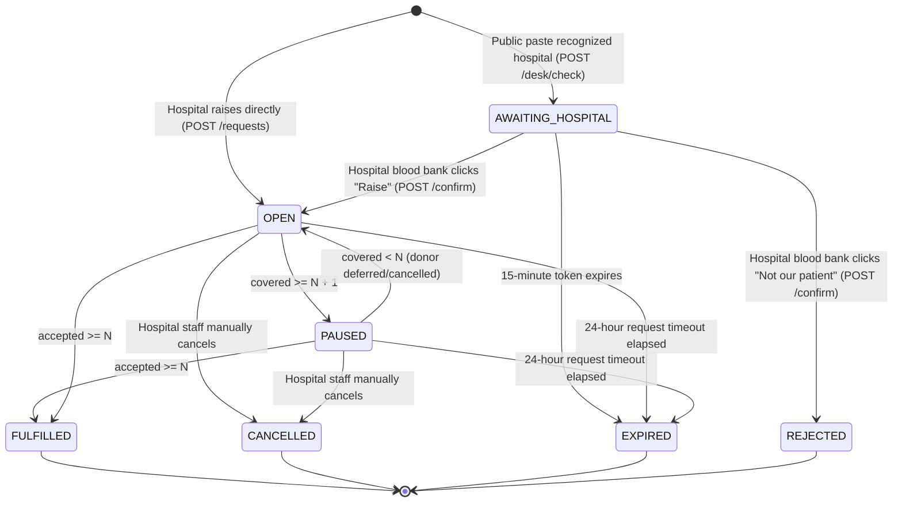
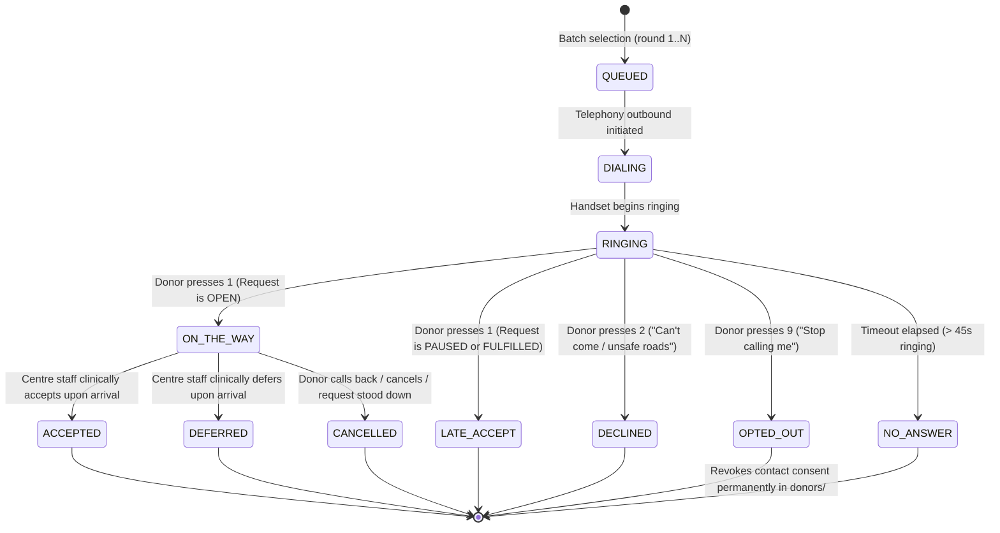
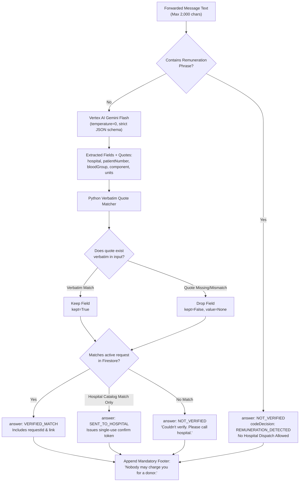

# U2U (Uyir2Uyir) Backend Brief & Architecture Specification

> **Source of truth for the backend coding agent.**
> This document adapts the U2U Project Brief for server-side architecture, domain rules, Pydantic contracts, data persistence, AI verification, and telephony orchestration.
> If implementation code and this specification disagree, stop and ask the human.

---

## 1. Product in One Paragraph

U2U (Uyir2Uyir, "life to life" in Tamil) relays urgent blood requests from verified hospitals to nearby consented donors via automated voice calls, dialling 5 donors at a time in Tamil or English until the request is covered. The backend is the **sole authority** over the $N+1$ counting rule, call state machines, and dispatch decisions. Blood centre medical staff, never the application or AI, decide who can donate. The public Request Desk verifies forwarded WhatsApp messages using a single Gemini Flash call on Vertex AI whose extracted quotes are verified verbatim in Python code.

**Ideology:** Life passes on. Freely. Safely. In time.

| Promise | Meaning | Backend Enforcement Mechanism |
|---|---|---|
| **Freely** | Life is given, never sold | Remuneration phrase detector blocks hospital dispatch; every Request Desk response mandates `"Nobody may charge you for a donor."` |
| **Safely** | Only real requests, only staff decide | Only verified hospital credentials can raise requests; only centre staff can accept/defer; donor phone numbers are encrypted and masked as aliases (e.g., "Donor A7"). |
| **In time** | No family searching alone at 2 a.m. | Batch-of-5 IVR outreach; automated pause at $N+1$; automatic reopen if a donor cancels; stand-down on fulfillment. |

**Hackathon & Deployment:**
- Google Cloud AI Builder Cup 2026 (Sustainability and Social Impact).
- Python 3.12 FastAPI modular monolith deployed on **Google Cloud Run** (`asia-south1`).
- Multi-database **Cloud Firestore** (`u2u-demo` and `u2u-live`).
- Vertex AI Gemini Flash (`gemini-2.0-flash` or `gemini-1.5-flash`) at temperature 0.

**Honesty Rule:** All mock and prototype data must be designated with `isSimulated: true`. The backend never attributes simulated handlers to live Gemini, Twilio, or Cloud TTS APIs.

---

## 2. Backend Modular Monolith Structure

The backend (`backend/app/`) is architected as an internal modular monolith where modules communicate through explicit Python interfaces, schemas, and service functions rather than network calls.

```
backend/
├── app/
│   ├── main.py                  # FastAPI application factory, middleware, CORS, routers
│   ├── core/                    # Shared settings, Firestore DB client, logging, errors
│   │   ├── config.py            # AppConfig, environment variables, DATA_MODE
│   │   ├── database.py          # Firestore async client provider (u2u-demo / u2u-live)
│   │   ├── exceptions.py        # Domain exception hierarchy and HTTP exception handlers
│   │   └── logging.py           # Structured Cloud Logging formatter
│   ├── auth/                    # Authentication & RBAC
│   │   ├── dependencies.py      # get_current_user, require_role, require_hospital, require_staff
│   │   ├── tokens.py            # Firebase Auth JWT decoder and validator
│   │   └── claims.py            # Custom claims parsing (role, hospitalId, centreId, env)
│   ├── requests/                # Blood request lifecycle management
│   │   ├── router.py            # POST /requests, POST /requests/{id}/cancel, GET /requests/{id}/status
│   │   ├── service.py           # Request creation, cancellation, status retrieval
│   │   └── models.py            # BloodRequest domain models and Pydantic schemas
│   ├── rules/                   # Deterministic business logic & counting rule
│   │   ├── engine.py            # Pure N+1 counting rule, pause/reopen/fulfill evaluation
│   │   ├── state_machine.py     # RequestStatus & CallState transition validators
│   │   └── stand_down.py        # Post-fulfillment donor stand-down calculation
│   ├── matching/                # Donor filtering and batch selection
│   │   ├── service.py           # Find eligible consented donors within radius
│   │   ├── compatibility.py     # ABO/Rh clinical compatibility matrix
│   │   └── batcher.py           # 5-donor batch selection and round ordering
│   ├── outreach/                # Voice dispatching and IVR bridge
│   │   ├── router.py            # POST /sim/calls/{id}/press, Twilio webhooks
│   │   ├── twilio_client.py     # Twilio Voice API client (live allowlist)
│   │   ├── simulator.py         # In-memory IVR call state manager for demo simulator
│   │   └── tts.py               # Google Cloud Text-to-Speech client & audio cache
│   ├── screening/               # Blood centre triage and clinical clearance
│   │   ├── router.py            # POST /calls/{id}/accept, POST /calls/{id}/defer
│   │   └── service.py           # Staff medical sign-off and deferral return-date scheduling
│   ├── desk/                    # Public WhatsApp verification & confirm tokens
│   │   ├── router.py            # POST /desk/check, GET /confirm/{token}, POST /confirm
│   │   ├── service.py           # Orchestrates Gemini extraction, quote checking, token generation
│   │   ├── token_manager.py     # Single-use HMAC/SHA-256 confirmation token issuance & redemption
│   │   └── remuneration.py      # Payment phrase keyword detection engine
│   ├── ai/                      # Vertex AI Gemini Flash integration
│   │   ├── client.py            # Vertex AI Gemini Flash client (temperature 0)
│   │   ├── schemas.py           # Strict JSON output schema for entity extraction
│   │   └── verifier.py          # Verbatim character-by-character quote matcher
│   ├── clock/                   # Background reconciliation & scheduled tasks
│   │   ├── router.py            # POST /clock/tick (Cloud Scheduler 1-minute cron)
│   │   └── tasks.py             # Expired request sweeps, call timeouts (45s), reminder triggers
│   └── admin/                   # Demo scenarios, reset, and operational toggles
│       ├── router.py            # POST /admin/scenario/{id}/run, POST /admin/reset, POST /admin/settings/weather
│       └── scenarios.py         # 6-step emergency dispatch scenario runner
├── eval/                        # Request Desk evaluation suite
│   ├── dataset.json             # 50 labelled WhatsApp test cases (English, Tamil, mixed)
│   └── runner.py                # Evaluation benchmark runner against active prompt/model
├── prompts/                     # Versioned Gemini extraction prompts
│   └── extraction_v1.txt        # Canonical Request Desk system and user prompts
├── tests/                       # Pytest test suites
│   ├── test_rules.py            # N+1 counting rule, pause, reopen, fulfill, late accept
│   ├── test_desk.py             # Quote verifier, payment blocker, answer categorization
│   ├── test_api.py              # FastAPI endpoint contracts and authentication
│   └── test_matching.py         # Blood group compatibility and batching
├── Dockerfile                   # Cloud Run production container build
├── pyproject.toml               # Poetry / pip dependencies (Python 3.12)
└── requirements.txt             # Production requirements
```

---

## 3. Core Domain Rules & State Machines

### 3.1 The $N+1$ Counting Rule

The counting rule is implemented as a **pure function** in `app/rules/engine.py` with zero side effects.

```python
def evaluate_request_state(
    units_needed: int,
    accepted: int,
    on_the_way: int,
    current_status: RequestStatus,
) -> RequestStatus:
    """
    N        = units needed
    covered  = accepted + on_the_way
    pause    when covered >= N + 1      (provides one spare donor)
    reopen   when covered < N           (coverage dropped below target)
    fulfil   when accepted >= N         (all units clinically accepted by centre staff)
    """
    if accepted >= units_needed:
        return RequestStatus.FULFILLED

    covered = accepted + on_the_way

    if covered >= units_needed + 1:
        return RequestStatus.PAUSED

    if covered < units_needed:
        if current_status == RequestStatus.PAUSED:
            return RequestStatus.OPEN  # Reopened

    return current_status
```

### 3.2 Request Lifecycle State Machine



### 3.3 Call Lifecycle & Keypad State Machine



### 3.4 Keypad Input Specifications

| DTMF Key | User Intent | Call Transition | Side Effect |
|---|---|---|---|
| `1` | *"I'm on my way"* | $\to$ `ON_THE_WAY` (if `OPEN`)<br>$\to$ `LATE_ACCEPT` (if `PAUSED` / `FULFILLED`) | Updates covered count; re-evaluates pause trigger. |
| `2` | *"I cannot donate / roads unsafe"* | $\to$ `DECLINED` | Frees slot; records inclement weather signal if alert is active. |
| `9` | *"Revoke consent / opt out"* | $\to$ `OPTED_OUT` | **Immediate Consent Revocation:** Sets `consentUrgent = False` on donor record in Firestore. Never calls donor again. |

---

## 4. Cloud Infrastructure & Google Services

```mermaid
flowchart TD
    subgraph Clients["Frontend Clients (Firebase Hosting)"]
        H[Hospital Screen /hospital]
        C[Blood Centre Screen /centre]
        D[Request Desk /desk]
        S[Simulator Screen /sim]
        J[Donor Join /join]
    end

    subgraph CloudRun["Google Cloud Run (asia-south1)"]
        FASTAPI["FastAPI Modular Monolith"]
        AUTH_MW["Firebase Auth Middleware"]
        ROUTES["App Routers"]
        SERVICES["Domain Services"]
        RULES_ENG["Rule Engine"]
    end

    subgraph GCP["Google Cloud Managed Services"]
        FS_DEMO[("Cloud Firestore\nu2u-demo")]
        FS_LIVE[("Cloud Firestore\nu2u-live")]
        VERTEX["Vertex AI\nGemini Flash (temperature=0)"]
        TTS["Cloud Text-to-Speech\n(Tamil / English)"]
        SCHED["Cloud Scheduler\n(1-min tick /clock/tick)"]
        SM["Secret Manager\n(Keys, Twilio Secrets)"]
        LOG["Cloud Logging\n(Structured JSON)"]
    end

    subgraph Telephony["Telephony Gateway"]
        TWILIO["Twilio Voice API\n(Live Allowlist)"]
    end

    Clients -->|HTTPS REST API| AUTH_MW
    AUTH_MW --> ROUTES --> SERVICES --> RULES_ENG
    
    Clients -.->|Snapshot Listeners (Read Only)| FS_DEMO
    Clients -.->|Snapshot Listeners (Read Only)| FS_LIVE

    SERVICES --> FS_DEMO
    SERVICES --> FS_LIVE
    SERVICES --> VERTEX
    SERVICES --> TTS
    SERVICES --> TWILIO
    SCHED -->|POST /clock/tick| ROUTES
    FASTAPI --> SM
    FASTAPI --> LOG
```

### Service Configurations

1. **Cloud Run:**
   - Region: `asia-south1` (Mumbai).
   - Concurrency: 80 per instance.
   - Autoscaling: Min 0, Max 10.
   - Environment variables: `DATA_MODE=demo|live`, `GCP_PROJECT`, `VERTEX_LOCATION=asia-south1`.
2. **Cloud Firestore:**
   - Database ID: `u2u-demo` (demo mode, mock records) or `u2u-live` (production deployment).
   - Mode governed by `config.DATA_MODE`.
   - Security rule: Public read-only snapshots allowed for frontend listeners; all writes blocked except service account.
3. **Vertex AI Gemini Flash:**
   - Endpoint: `asia-south1-aiplatform.googleapis.com`.
   - Model: `gemini-2.0-flash` or `gemini-1.5-flash`.
   - Parameters: `temperature=0.0`, `max_output_tokens=1024`, `response_mime_type="application/json"`.
4. **Cloud Text-to-Speech:**
   - Voices: `ta-IN-Standard-A` / `ta-IN-Wavenet-A` (Tamil), `en-IN-Standard-A` (English).
   - Audio Format: MP3 / linear16 for telephony playback.

---

## 5. Firestore Persistence & Data Schema

### 5.1 Collection Layout

```
/requests/{requestId}
    ├── calls/{callId}
    └── events/{eventId}

/donors/{donorId}
/hospitals/{hospitalId}
/centres/{centreId}
/confirm_tokens/{tokenHash}
/eval_results/{evalId}
/app_config/global
```

### 5.2 Document Schemas

#### Collection: `requests/{requestId}`
```json
{
  "id": "req-8f92b1",
  "hospitalId": "hosp-chennai-gh",
  "hospitalName": "Rajiv Gandhi Government General Hospital",
  "centreId": "centre-chennai-main",
  "centreName": "Chennai Central Blood Centre",
  "bloodGroup": "O+",
  "component": "RED_CELLS",
  "unitsNeeded": 2,
  "status": "OPEN",
  "accepted": 0,
  "onTheWay": 0,
  "round": 1,
  "patientRef": "IP-94021",
  "createdAt": "2026-10-14T10:00:00Z",
  "updatedAt": "2026-10-14T10:00:00Z",
  "expiresAt": "2026-10-15T10:00:00Z",
  "isSimulated": true
}
```
*Note: `patientRef` is stripped by serialization models when served to public or donor endpoints.*

#### Subcollection: `requests/{requestId}/calls/{callId}`
```json
{
  "id": "call-101",
  "requestId": "req-8f92b1",
  "donorId": "donor-uuid-441",
  "donorAlias": "Donor A7",
  "bloodGroup": "O+",
  "lang": "ta",
  "state": "RINGING",
  "round": 1,
  "etaMinutes": 25,
  "distanceKm": 4.2,
  "dialedAt": "2026-10-14T10:01:00Z",
  "answeredAt": null,
  "updatedAt": "2026-10-14T10:01:15Z"
}
```

#### Subcollection: `requests/{requestId}/events/{eventId}`
```json
{
  "id": "evt-001",
  "requestId": "req-8f92b1",
  "at": "2026-10-14T10:01:00Z",
  "kind": "ROUND_STARTED",
  "text": "Round 1 dispatched to 5 nearby O+ donors in Tamil."
}
```

#### Collection: `donors/{donorId}`
```json
{
  "id": "donor-uuid-441",
  "alias": "Donor A7",
  "name": "Murugan S",
  "phoneEncrypted": "kms:enc:...",
  "phoneLast4": "4819",
  "bloodGroup": "O+",
  "area": "T. Nagar, Chennai",
  "pinCode": "600017",
  "lang": "ta",
  "lastDonationDate": "2026-06-10",
  "consentUrgent": true,
  "consentHistory": true,
  "isAdultAttested": true,
  "createdAt": "2026-10-14T08:00:00Z",
  "updatedAt": "2026-10-14T08:00:00Z"
}
```

#### Collection: `confirm_tokens/{tokenHash}`
```json
{
  "tokenHash": "e3b0c44298fc1c149afbf4c8996fb92427ae41e4649b934ca495991b7852b855",
  "hospitalId": "hosp-chennai-gh",
  "hospitalName": "Rajiv Gandhi Government General Hospital",
  "bloodGroup": "O+",
  "component": "RED_CELLS",
  "unitsNeeded": 2,
  "patientRefMasked": "IP-***21",
  "rawPatientRef": "IP-94021",
  "used": false,
  "expiresAt": "2026-10-14T10:15:00Z",
  "createdAt": "2026-10-14T10:00:00Z"
}
```

---

## 6. Python Data Contracts & Pydantic Schemas

All schemas strictly mirror `docs/API_CONTRACT.md` and `frontend/src/api/types.ts`.

```python
from enum import Enum
from typing import Optional, List, Generic, TypeVar
from pydantic import BaseModel, Field

class BloodGroup(str, Enum):
    A_POS = "A+"
    A_NEG = "A-"
    B_POS = "B+"
    B_NEG = "B-"
    AB_POS = "AB+"
    AB_NEG = "AB-"
    O_POS = "O+"
    O_NEG = "O-"

class Component(str, Enum):
    WHOLE_BLOOD = "WHOLE_BLOOD"
    RED_CELLS = "RED_CELLS"
    PLATELETS_SDP = "PLATELETS_SDP"
    PLATELETS_RDP = "PLATELETS_RDP"
    PLASMA = "PLASMA"
    UNSPECIFIED = "UNSPECIFIED"

class RequestStatus(str, Enum):
    AWAITING_HOSPITAL = "AWAITING_HOSPITAL"
    OPEN = "OPEN"
    PAUSED = "PAUSED"
    FULFILLED = "FULFILLED"
    EXPIRED = "EXPIRED"
    CANCELLED = "CANCELLED"
    REJECTED = "REJECTED"

class CallState(str, Enum):
    QUEUED = "QUEUED"
    DIALING = "DIALING"
    RINGING = "RINGING"
    ON_THE_WAY = "ON_THE_WAY"
    ACCEPTED = "ACCEPTED"
    DEFERRED = "DEFERRED"
    DECLINED = "DECLINED"
    NO_ANSWER = "NO_ANSWER"
    UNKNOWN = "UNKNOWN"
    OPTED_OUT = "OPTED_OUT"
    LATE_ACCEPT = "LATE_ACCEPT"
    CANCELLED = "CANCELLED"

class Lang(str, Enum):
    EN = "en"
    TA = "ta"

class AppConfig(BaseModel):
    dataMode: str = Field(pattern="^(demo|live)$")
    bannerText: Optional[str] = None
    weatherAlert: bool = False

class BloodRequest(BaseModel):
    id: str
    hospitalId: str
    hospitalName: str
    centreId: str
    centreName: str
    bloodGroup: BloodGroup
    component: Component
    unitsNeeded: int = Field(ge=1, le=6)
    status: RequestStatus
    accepted: int = 0
    onTheWay: int = 0
    round: int = 1
    createdAt: str
    updatedAt: str
    expiresAt: str
    isSimulated: bool = True
    patientRef: Optional[str] = None

class Call(BaseModel):
    id: str
    requestId: str
    donorAlias: str
    bloodGroup: BloodGroup
    lang: Lang
    state: CallState
    round: int
    etaMinutes: Optional[int] = None
    distanceKm: float
    updatedAt: str

T = TypeVar("T")

class QuotedField(BaseModel, Generic[T]):
    value: Optional[T] = None
    quote: Optional[str] = None
    kept: bool = False

class DeskTrace(BaseModel):
    hospital: QuotedField[str]
    patientNumber: QuotedField[str]
    bloodGroup: QuotedField[BloodGroup]
    component: QuotedField[Component]
    units: QuotedField[int]
    paymentPhrases: List[str] = []
    geminiChoice: str
    codeDecision: str

class DeskResult(BaseModel):
    answer: str = Field(pattern="^(VERIFIED_MATCH|SENT_TO_HOSPITAL|NOT_VERIFIED)$")
    message: str
    requestId: Optional[str] = None
    hospitalName: Optional[str] = None
    trace: DeskTrace
    footer: str = "Nobody may charge you for a donor."
    demoConfirmToken: Optional[str] = None
```

---

## 7. Complete API Endpoint Routing Table

| Method | Path | Auth / Role | Request Body | Response Model | HTTP Status |
|---|---|---|---|---|---|
| `GET` | `/config` | Anonymous | None | `AppConfig` | 200 |
| `POST` | `/requests` | `hospital` | `{bloodGroup, component, unitsNeeded, patientRef}` | `BloodRequest` | 201 |
| `POST` | `/requests/{id}/cancel` | `hospital` | None | `BloodRequest` | 200 |
| `GET` | `/requests/{id}/status` | Anonymous | None | `PublicStatus` | 200 |
| `POST` | `/desk/check` | Anonymous | `{text}` (capped at 2,000 chars) | `DeskResult` | 200 |
| `GET` | `/confirm/{token}` | Hospital staff | None | `RequestPreview` | 200 |
| `POST` | `/confirm` | Hospital staff | `{token, action: 'RAISE'\|'NOT_OUR_PATIENT'}` | `BloodRequest` or `{status: 'REJECTED'}` | 200 |
| `POST` | `/sim/calls/{callId}/press` | Demo only | `{key: '1'\|'2'\|'9'}` | `Call` | 200 |
| `POST` | `/calls/{callId}/accept` | `staff` | None | `Call` | 200 |
| `POST` | `/calls/{callId}/defer` | `staff` | `{returnDate?: string}` | `Call` | 200 |
| `POST` | `/donors/signup` | Anonymous | `{name, phone, bloodGroup, area, lang, consentUrgent, consentHistory, adult}` | `{donorAlias: string}` | 201 |
| `GET` | `/metrics` | Signed-in demo/staff | None | `Metrics` | 200 |
| `GET` | `/eval/latest` | Anonymous | None | `EvalResult` | 200 |
| `POST` | `/clock/tick` | OIDC Cloud Scheduler | None | `{ticked: int, expired: int, timeouts: int}` | 200 |
| `POST` | `/admin/scenario/{id}/run` | Demo only | None | `{ok: true, step: int}` | 200 |
| `POST` | `/admin/reset` | Demo only | None | `{ok: true}` | 200 |
| `POST` | `/admin/settings/weather` | `staff` | `{on: boolean}` | `AppConfig` | 200 |
| `POST` | `/auth/demo-role` | Demo only | `{role: 'hospital'\|'staff'}` | `{ok: true}` | 200 |

---

## 8. Gemini Flash AI Pipeline & Verification Engine

### 8.1 Extraction Execution Flow



### 8.2 Remuneration Detection Keyword List
Located in `app/desk/remuneration.py`:
- English: `"paid donor"`, `"payment"`, `"charge"`, `"cash"`, `"money"`, `"reward"`, `"compensation"`, `"cost per unit"`, `"price"`, `"rupees"`, `"rs."`, `"inr"`.
- Tamil: `"பணம்"`, `"விலை"`, `"கூலி"`, `"வெகுமதி"`, `"கட்டணம்"`.

### 8.3 Strict Verbatim Quote Verification Code
```python
def verify_quote(original_text: str, quote: Optional[str]) -> bool:
    """Verifies that an extracted quote exists word-for-word in the source message."""
    if not quote or not quote.strip():
        return False
    # Exact substring match, preserving unicode accents and spacing
    return quote.strip() in original_text
```

---

## 9. Telephony & Audio Outreach Pipeline

1. **Batching:** Donors matched by blood compatibility and geographic radius are dialled in rounds of **exactly 5**.
2. **IVR Audio Prompts:**
   - English: *"This is U2U calling on behalf of {hospitalName}. An urgent blood request is open for {bloodGroup} {component}. Press 1 if you can come to the blood bank now. Press 2 if you cannot. Press 9 to stop receiving calls."*
   - Tamil: *"இது U2U அவசர இரத்த அழைப்பு. {hospitalName} மருத்துவமனையில் {bloodGroup} இரத்தத்திற்கு அவசர தேவை உள்ளது. நீங்கள் இப்போது இரத்த வங்கிக்கு வர முடிந்தால் 1-ஐ அழுத்தவும். வர இயலாவிட்டால் 2-ஐ அழுத்தவும். இனி இதுபோன்ற அழைப்புகள் தேவையில்லை எனில் 9-ஐ அழுத்தவும்."*
3. **Inclement Weather Injection:**
   - If `AppConfig.weatherAlert == True`, the audio appends:
     - English: *"If roads near you are unsafe because of rain, please press 2."*
     - Tamil: *"மழை காரணமாக உங்கள் அருகிலுள்ள சாலைகள் பாதுகாப்பற்றதாக இருந்தால், தயவுசெய்து 2-ஐ அழுத்தவும்."*
4. **Simulator Mode:** In demo mode (`DATA_MODE=demo`), instead of initiating live Twilio calls, active calls transition to `RINGING` in Firestore and are picked up by the `/sim` interactive handset interface.

---

## 10. Clock Reconciliation Engine (`/clock/tick`)

Triggered every 60 seconds by **Cloud Scheduler**:
1. **Request Expiration Sweep:** Checks all requests with status `OPEN` or `PAUSED` where `expiresAt <= now()`; transitions them to `EXPIRED`.
2. **Call Timeout Sweep:** Checks active calls in `RINGING` where `now() - dialedAt > 45s`; transitions state to `NO_ANSWER`.
3. **Round Progression:** If a round has 0 active calls remaining (`RINGING` or `DIALING`) and the request is still `OPEN`, initiates the next round of 5 donors.
4. **Token Expiration:** Purges expired single-use confirmation tokens older than 15 minutes.

---

## 11. Testing & Benchmark Standards

1. **Deterministic Rule Unit Tests (`tests/test_rules.py`):**
   - 100% test coverage over $N+1$ counting rule edge cases.
   - Verified state machine transitions: `OPEN` $\to$ `PAUSED` $\to$ `OPEN` $\to$ `FULFILLED`.
   - Late accept transitions: press 1 after pause/fulfill transitions to `LATE_ACCEPT`.
2. **AI Safety Benchmark Suite (`eval/runner.py`):**
   - 50 labelled WhatsApp messages evaluated against Vertex AI Gemini Flash.
   - Zero tolerance: `paymentToHospital == 0` (100% rejection of paid blood requests).
   - Zero tolerance: `wrongHospitalIds == 0` (zero hallucinated hospital identifications).
   - Latency target: P95 latency $< 2,500\text{ ms}$.
3. **Integration Tests (`tests/test_api.py`):**
   - Validates all 17 FastAPI endpoints against schemas in `docs/API_CONTRACT.md`.
