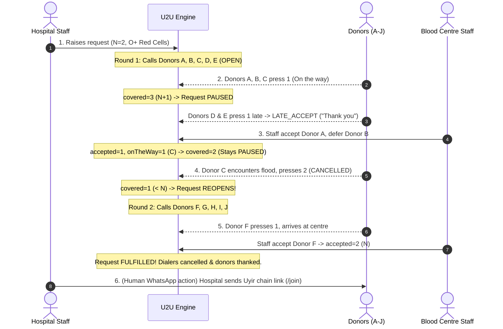

# U2U Demonstration & Evaluation Guide

> **Status:** built (Demo runner, simulated IVR handset, and scenario execution implemented)

This guide documents the 6-step emergency dispatch scenario, the 2-minute judge walkthrough, and the demo environment access procedures for U2U (Uyir2Uyir).

---

## 1. The 6-Step Demo Scenario: 2 Units of O+ Red Cells

The core demonstration follows an urgent hospital request for **$N = 2$ units of O+ packed red blood cells**. 

Under the $N+1$ counting rule:
$$\text{covered} = \text{accepted} + \text{onTheWay}$$
- **Pause outreach** when $\text{covered} \ge N + 1$ ($2 + 1 = 3$ donors committed, providing one spare).
- **Reopen outreach** if $\text{covered} < N$ (falls below 2 due to dropouts or deferrals).
- **Fulfil request** when $\text{accepted} \ge N$ (2 units physically collected).

### Step-by-Step Walkthrough:
1. **Hospital Raises Request:** Hospital staff navigate to `/hospital` and submit a request for 2 units of O+ red blood cells with patient reference `PT-8941`. The system enters `OPEN` status and initiates Round 1, dispatching calls to Donors A through E.
2. **Donors Respond & N+1 Pause:** Donors A, B, and C answer their calls and press `1` ("On the way"). Covered reaches 3 ($\ge N+1$). The outreach engine automatically **pauses** additional dialing. When Donors D and E subsequently press `1`, the system records them as `LATE_ACCEPT`, politely thanking them and explaining that enough donors are already en route.
3. **Blood Centre Screening:** Donors arrive at the blood bank (`/centre`). Staff verify Donor A and click **Accept**. Staff evaluate Donor B, identify low hemoglobin (11.8 g/dL), and click **Defer** with a 30-day return reminder. Current state: 1 accepted, 1 on the way (Donor C), covered = 2. The request remains **paused**.
4. **En-Route Dropout & Automatic Reopening:** While en route, Donor C encounters heavy traffic/road flooding from an IMD weather alert and responds with `2` on a confirmation prompt. Donor C transitions to `CANCELLED`. Covered drops to 1 ($< N$). The engine immediately **reopens** the request, launching Round 2 outreach to Donors F through J.
5. **Fulfillment & Standing Down:** Donor F presses `1`, arrives at the blood centre, and is accepted by staff. Accepted reaches 2 ($= N$). The request transitions to **`FULFILLED`**. All remaining ringing calls in Round 2 are stood down (`CANCELLED`), and any remaining en route donors are sent a thank-you stand-down notification.
6. **The Uyir Chain (Human Action):** Blood bank staff, from their own official hospital WhatsApp account, send the gratitude message to the patient's family:
   > *"Someone gave life to your family today. When you're ready, you can do the same."*
   Accompanied by the public consent link: `https://u2u.org.in/join`.

*Note: Steps 1 through 5 are executed automatically by the backend scenario runner (`backend/app/clock/story.py` via `POST /admin/scenario/demo-o-plus/run`). Step 6 is an intentional human action.*

### Backend Scenario Architecture:
The backend demo runner (`run_story()`) plays steps 1 to 5 exclusively through production domain services without bypassing transactions or writing raw database documents:
1. **Step 1:** Dispatches `POST /requests` for 2 units of O+ red blood cells at Kauvery Hospital (`req_story_o_plus`). Automatically runs Round 1 matching and dispatches calls to Donors A–E.
2. **Step 2:** Dispatches simulated DTMF key `1` for Donors A, B, and C. The request pauses ($N+1=3$). Donors D and E respond late and are marked `LATE_ACCEPT`.
3. **Step 3:** Dispatches staff `POST /calls/{callId}/accept` for Donor A and `POST /calls/{callId}/defer` for Donor B (30 days). Request remains paused (covered = 2).
4. **Step 4:** Advances simulated clock and dispatches en-route cancellation (DTMF `2`) for Donor C due to flood warning. Covered drops to 1 ($< N$), reopening the request and triggering Round 2 outreach to Donors F–J.
5. **Step 5:** Donor F presses `1` and staff accepts Donor F. Accepted reaches 2 ($= N$), transitioning the request to `FULFILLED` and standing down all remaining dialers and en-route donors.
Between each step, `run_story()` appends a `TimelineEvent` with text `Story step N: ...` and advances the simulation clock so that `GET /metrics` produces realistic coordination timings.

---

## 2. 2-Minute Judge Walkthrough Script (Exact Clicks)

For evaluators reviewing the prototype live:

| Step | Screen | Exact Click & Expected Behavior |
|---|---|---|
| **1. Guided Story Mode** | `/` (Home) | **Click "Run the story"** in the top orange banner. • The app **immediately navigates to `/centre`**. • An animated live step badge appears in the banner: *"Step 1 of 5"*, *"Step 2 of 5"*, ..., *"Step 5 of 5"*. • Watch the live round dials, the $N+1$ transition to `PAUSED`, staff screening, dropout reopening, and fulfillment in real time. |
| **2. Coordination Impact** | `/impact` | **Click "Impact"** in the top nav. • Inspect the 3 StatTiles: **"Time to first donor on the way"** (3m vs 45m baseline, 93% faster), **"Time to covered"** (8m vs 90m baseline, 91% faster), and **"Time to fulfilled"** (48m vs 180m baseline, 73% faster). • Verify **Calls per accepted donor** (~5 calls vs ~30+ broadcast blasts) and **Stand-down reach** (100% of excess donors thanked/stood down with zero unnotified arrivals). • Notice the prominent label: *"Simulated data from demo runs"*. |
| **3. AI Safety Benchmarks** | `/eval` | **Click "AI Eval"** in the top nav. • Observe the badge: *"Sample: replaced by the real backend eval run"*. • Verify **0 Payment messages sent to hospital** (mandatory NBTC compliance) and **0 Wrong hospital IDs** (strict entity catalog matching). • Inspect the benchmark table showing test samples and green **PASS** badges. |
| **4. Public Request Desk** | `/desk` | **Click "Request Desk"** in the top nav. • Click the sample chip **"Verified Match (English)"** and press **"Check message"**. • Expand **"How U2U checked this"** to verify transparent Gemini quote extraction validated word-for-word by deterministic code rules. • Observe the mandatory footer stripe: *"Nobody may charge you for a donor."* |
| **5. Donor Join with Consent** | `/join` | **Click "Join as donor"** in the top nav. • Verify the bilingual toggle (`EN / த`), the data collection & withdrawal notice, and the two unticked consent checkboxes. • Notice the **Join** button remains disabled until urgent consent and the 18+ attestation are checked. • Enter phone number, submit, and confirm that the raw phone number is strictly **never displayed back**. |
| **6. Reset Demo** | Any screen | **Click "Reset demo"** in the top banner. • Wipes demo state, clears timeline metrics, and re-seeds pristine initial fixtures. |

---

### Impact & Evaluation Dashboards

*Coordination Impact: StatTiles contrasting U2U targeted round dispatch against the uncoordinated broadcast baseline.*

*AI Verification Benchmarks: Safety metrics and test cases verifying zero payment routing and zero wrong hospital IDs.*

---

## 3. How to Log In to the Demo

Because emergency blood coordination spans multiple roles, U2U includes a zero-friction **Role Switcher** in the navigation header:

1. **Open the Demo App:** Visit `http://localhost:5173/` (or deployed Firebase URL).
2. **Global Indicator:** Confirm the top banner displays:
   `🟧 SIMULATED DATA — All hospitals, donors and patients shown are simulated.`
3. **One-Tap Role Switching:** Use the top bar switcher to toggle between:
   - **Hospital Staff:** Pre-authenticated to *Kauvery Hospital, Chennai* (access to `/hospital`).
   - **Blood Centre Staff:** Pre-authenticated to *Rotary Central Blood Bank* (access to `/centre`).
   - **Public Request Desk:** No login required (access to `/desk`).
   - **Donor Simulator:** Access to `/sim` to test interactive DTMF responses.
   - **Impact Dashboard:** Access to `/impact` to review computed timeline metrics.
   - **AI Evaluation:** Access to `/eval` to inspect Gemini extraction accuracy and safety benchmarks.
4. **Resetting Demo State:** At any point, clicking **"Reset demo"** in the top banner issues a `POST /admin/reset` call, wiping in-memory states and restoring pristine scenario fixtures.
