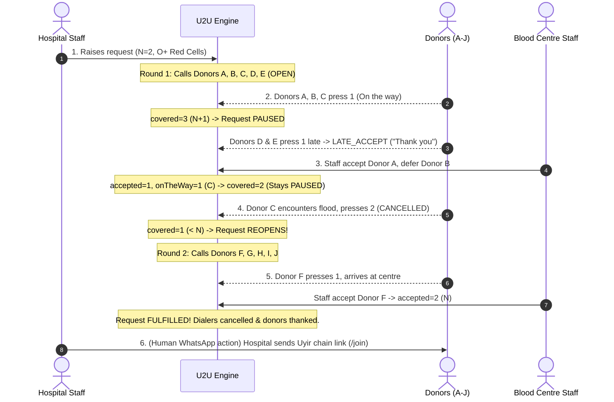

# U2U Demonstration & Evaluation Guide

> **Status:** planned (Demo runner and simulation screens scheduled for implementation)

This guide documents the 6-step emergency dispatch scenario, the 2-minute judge walkthrough, and the demo environment access procedures for U2U (Uyir2Uyir).

---

## 1. The 6-Step Demo Scenario: 2 Units of O+ Red Cells

The core demonstration follows an urgent hospital request for **$N = 2$ units of O+ packed red blood cells**. 

Under the $N+1$ counting rule:
$$\text{covered} = \text{accepted} + \text{onTheWay}$$
- **Pause outreach** when $\text{covered} \ge N + 1$ ($2 + 1 = 3$ donors committed, providing one spare).
- **Reopen outreach** if $\text{covered} < N$ (falls below 2 due to dropouts or deferrals).
- **Fulfil request** when $\text{accepted} \ge N$ (2 units physically collected).

### Step-by-Step Walkthrough:
1. **Hospital Raises Request:** Hospital staff navigate to `/hospital` and submit a request for 2 units of O+ red blood cells with patient reference `PT-8941`. The system enters `OPEN` status and initiates Round 1, dispatching calls to Donors A through E.
2. **Donors Respond & N+1 Pause:** Donors A, B, and C answer their calls and press `1` ("On the way"). Covered reaches 3 ($\ge N+1$). The outreach engine automatically **pauses** additional dialing. When Donors D and E subsequently press `1`, the system records them as `LATE_ACCEPT`, politely thanking them and explaining that enough donors are already en route.
3. **Blood Centre Screening:** Donors arrive at the blood bank (`/centre`). Staff verify Donor A and click **Accept**. Staff evaluate Donor B, identify low hemoglobin (11.8 g/dL), and click **Defer** with a 30-day return reminder. Current state: 1 accepted, 1 on the way (Donor C), covered = 2. The request remains **paused**.
4. **En-Route Dropout & Automatic Reopening:** While en route, Donor C encounters heavy traffic/road flooding from an IMD weather alert and responds with `2` on a confirmation prompt. Donor C transitions to `CANCELLED`. Covered drops to 1 ($< N$). The engine immediately **reopens** the request, launching Round 2 outreach to Donors F through J.
5. **Fulfillment & Standing Down:** Donor F presses `1`, arrives at the blood centre, and is accepted by staff. Accepted reaches 2 ($= N$). The request transitions to **`FULFILLED`**. All remaining ringing calls in Round 2 are stood down (`CANCELLED`), and any remaining en route donors are sent a thank-you stand-down notification.
6. **The Uyir Chain (Human Action):** Blood bank staff, from their own official hospital WhatsApp account, send the gratitude message to the patient's family:
   > *"Someone gave life to your family today. When you're ready, you can do the same."*
   Accompanied by the public consent link: `https://u2u.org.in/join`.

*Note: Steps 1 through 5 are played automatically by the scenario runner (`POST /admin/scenario/demo-o-plus/run`). Step 6 is an intentional human action.*

---

## 2. 2-Minute Judge Walkthrough Script

For evaluators reviewing the prototype live:

| Timestamp | Screen | Action & Narration |
|---|---|---|
| **0:00 - 0:30** | `/` (Home) | **The Three Promises:** Observe the clean, warm-paper aesthetic and the prominent orange `"SIMULATED DATA"` banner. Note the philosophy: *Freely, Safely, In time.* Click **"Run the story"** to launch the scenario. |
| **0:30 - 1:00** | `/hospital` & `/sim` | **Targeted Dispatch:** View the hospital screen showing *Round 1 (5 donors)*. Switch to the interactive phone frame on `/sim`, hear the simulated Tamil/English audio script, and press `1` to commit. Watch the hospital banner animate: *"1 on the way of 2"*. |
| **1:00 - 1:30** | `/centre` | **The N+1 Rule & Human Authority:** Notice the status transition to `PAUSED` when 3 donors commit. As blood centre staff, physically accept Donor A and defer Donor B. Watch the system automatically reopen Round 2 when Donor C cancels. |
| **1:30 - 2:00** | `/desk` | **Public Request Desk:** Paste a forwarded WhatsApp message containing mixed Tamil/English text and emergency details. Inspect the **Trace Panel**: verify that Gemini Flash extracted entities with 100% verbatim substring quotes validated by Python code. Observe the mandatory footer: *"Nobody may charge you for a donor."* |

---

## 3. How to Log In to the Demo

Because emergency blood coordination spans multiple roles, U2U includes a zero-friction **Role Switcher** in the navigation header:

1. **Open the Demo App:** Visit `http://localhost:5173/` (or deployed Firebase URL).
2. **Global Indicator:** Confirm the top banner displays:
   `🟧 SIMULATED DATA — All hospitals, donors and patients shown are simulated.`
3. **One-Tap Role Switching:** Use the top bar switcher to toggle between:
   - **Hospital Staff:** Pre-authenticated to *Kauvery Hospital, Chennai* (access to `/hospital`).
   - **Blood Centre Staff:** Pre-authenticated to *Rotary Central Blood Bank* (access to `/centre`).
   - **Public Request Desk:** No login required (access to `/desk`).
   - **Donor Simulator:** Access to `/sim` to test interactive DTMF responses.
4. **Resetting Demo State:** At any point, clicking **"Reset Demo Data"** in the navigation menu issues a `POST /admin/reset` call, wiping in-memory states and restoring pristine scenario fixtures.
