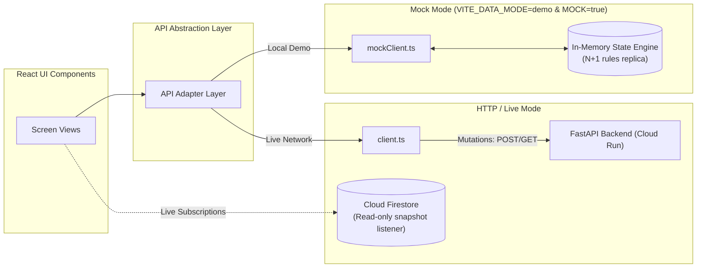

# U2U Frontend Architecture & Build Log

> **Status:** planned (Frontend implementation begins in Milestone 1)

This document details the route architecture, directory structure, data flow modes, and cumulative build history for the U2U frontend web client.

---

## 1. Routes & Screens

The application is a single-page application built with React Router, structured around role-based workflows and public verification:

| Route | Target User | Primary Action | Screen Description |
|---|---|---|---|
| `/` | Public / Evaluators | Choose a role / run demo | Value proposition, the three promises, role selector cards, and "Run the story" instant demo trigger. |
| `/hospital` | Hospital Blood Bank Staff | Raise urgent request | Request form: blood group, component, units ($N$), patient reference (`patientRef`). Live progress banner (*"1 on the way of 2"*) and mini event timeline. |
| `/centre` | Blood Centre Staff | Accept / defer arriving donor | Real-time triage dashboard: active requests, donor call rows with alias & ETA, live timeline, IMD weather alert emergency toggle. |
| `/desk` | Public (families, volunteers) | Verify forwarded message | Multi-line text input (max 2,000 chars), one of three verified answers, collapsible Gemini trace panel, fixed safety footer *"Nobody may charge you for a donor."* |
| `/confirm/:token` | Hospital Blood Bank | Confirm desk message | Single-use secure token view showing extracted request preview (`RequestPreview`) with action buttons: *"Raise this request"* or *"Not our patient"*. |
| `/join` | Prospective Donors | Register consent | Donor registration form in English and Tamil, two unselected consent checkboxes, 18+ age verification attestation. |
| `/sim` | Judges / Evaluators (Demo) | Simulate IVR keypad | Interactive telephone frame rendering simulated incoming voice calls with audio script and keypad buttons (1 = Coming, 2 = Can't, 9 = Opt out). |
| `/impact` | Staff / Judges | Review dispatch impact | 3 core metrics: time to first donor on the way, time to covered, time to fulfilled, contrasted against simulated broadcast baseline. |
| `/eval` | Judges / Engineers | Inspect AI accuracy | Real-time evaluation results of the labelled Request Desk test set: prompt version, accuracy, zero-payment pass rate, P95 latency. |

---

## 2. Frontend Directory Structure

```
frontend/
├── public/
│   └── favicon.svg
├── src/
│   ├── api/
│   │   ├── client.ts                # API client interface
│   │   ├── types.ts                 # Canonical TypeScript contracts matching API_CONTRACT.md
│   │   ├── mock/                    # In-memory mock API client
│   │   └── http/                    # HTTP REST client
│   ├── components/                  # Shared UI components
│   │   ├── AppShell.tsx             # Responsive header, navigation, and persistent DemoBanner
│   │   └── DemoBanner.tsx           # Orange SIMULATED DATA alert
│   ├── features/                    # Feature route views
│   │   ├── hospital/                # HospitalPage (/hospital)
│   │   ├── centre/                  # CentrePage (/centre)
│   │   ├── desk/                    # DeskPage (/desk)
│   │   ├── confirm/                 # ConfirmPage (/confirm/:token)
│   │   ├── join/                    # JoinPage (/join)
│   │   ├── sim/                     # SimPage (/sim)
│   │   ├── impact/                  # ImpactPage (/impact)
│   │   ├── eval/                    # EvalPage (/eval)
│   │   ├── landing/                 # LandingPage (/)
│   │   └── NotFoundPage.tsx         # 404 handler
│   ├── i18n/                        # Internationalization
│   │   ├── en.ts                    # English strings
│   │   ├── ta.ts                    # Tamil strings
│   │   └── useT.ts                  # Language hook
│   ├── styles/
│   │   └── tokens.css               # Design system color tokens (light & dark)
│   ├── lib/
│   │   ├── format.ts                # Blood group and masking formatters
│   │   └── time.ts                  # Relative time and ETA formatters
│   ├── test/
│   │   └── setup.ts                 # Vitest test setup with @testing-library/jest-dom
│   ├── App.test.tsx                 # Smoke test for landing page
│   ├── App.tsx                      # App router and shell layout
│   ├── main.tsx                     # Entrypoint mount
│   ├── routes.tsx                   # Route definitions for all 9 paths + 404
│   └── index.css                    # Tailwind CSS v4 entrypoint
├── package.json
├── tsconfig.json
├── tsconfig.app.json
├── tsconfig.node.json
└── vite.config.ts
```

---

## 3. Data Flow: Mock Mode vs HTTP Mode

The frontend supports seamless dual-mode execution controlled by `VITE_DATA_MODE`:



### 3.1 Mock Mode
- **Zero-Latency Evaluation:** Designed for judges and offline evaluations where Cloud Run backend connectivity is absent.
- **In-Memory Rule Imitation:** `mockClient.ts` emulates the exact $N+1$ counting rule, state transitions, donor round dials, and Request Desk responses defined in `backend/app/rules/`.
- **Honesty Rule:** Mock handlers never attribute simulated responses to live Gemini or Twilio APIs.

### 3.2 HTTP / Live Mode
- **Mutations via REST:** All user actions (creating requests, accepting donors, submitting desk text) invoke authenticated backend endpoints on Cloud Run.
- **Snapshot Streaming:** High-frequency UI updates (`/hospital`, `/centre`, `/sim`) listen directly to Cloud Firestore collection snapshots for sub-second reactive updates.

---

## 4. Development Commands

Run from `frontend/`:
- `npm run dev`: Launch Vite local development server.
- `npm run build`: Typecheck with TypeScript strict mode and build production bundle.
- `npm run lint`: Lint source files using Oxlint.
- `npm test`: Run test suite with Vitest.
- `npm run preview`: Preview production build locally.

---

## 5. Build Log

Cumulative record of frontend updates and milestones:

### Prompt #0a — 2026-10-13
- **Action:** Scaffolded repository architecture, root instructions, agent guardrails, and backend package placeholders.
- **Status:** Initialized monorepo boundaries and frontend constraints.

### Prompt #0b — 2026-10-13
- **Action:** Authored core system documentation set including `docs/FRONTEND.md`, defining all 9 application routes, component catalog, dual data-flow architecture, and accessibility baselines.
- **Status:** Complete. Ready for Milestone 1 frontend Vite scaffolding.

### Prompt #1 — 2026-10-14
- **Action:** Scaffolded React 19 + TypeScript (strict) + Vite application in `frontend/`. Installed allowed dependencies (Tailwind v4 via `@tailwindcss/vite`, React Router DOM, Lucide React, Radix primitives, Firebase SDK, Vitest, Testing Library, jsdom, axe-core). Implemented design system tokens in `src/styles/tokens.css`, all 9 route placeholders in `src/features/`, 404 handler, i18n dictionary stubs, format helpers, and smoke test in `src/App.test.tsx`.
- **Status:** Complete. `npm run build`, `npm run lint`, and `npm test` verified cleanly with 0 errors.
