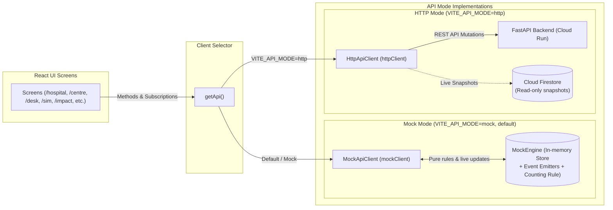

# U2U Frontend Architecture & Build Log

> **Status:** planned (Frontend implementation begins in Milestone 1)

This document details the route architecture, directory structure, data flow modes, and cumulative build history for the U2U frontend web client.

---

## 1. Routes & Screens

The application is a single-page application built with React Router, structured around role-based workflows and public verification:

| Route | Target User | Primary Action | Screen Description |
|---|---|---|---|
| `/` | Public / Evaluators | Choose a role / run demo | Value proposition, the three promises, role selector cards, and "Run the story" instant demo trigger. |
| `/hospital` | Hospital Blood Bank Staff | Raise urgent request | Request form: blood group, component, units ($N$), patient reference (`patientRef`). Live progress banner (*"1 on the way of 2"*) and mini event timeline. |
| `/centre` | Blood Centre Staff | Accept / defer arriving donor | Real-time triage dashboard: active requests, donor call rows with alias & ETA, live timeline, IMD weather alert emergency toggle. |
| `/desk` | Public (families, volunteers) | Verify forwarded message | Multi-line text input (max 2,000 chars), one of three verified answers, collapsible Gemini trace panel, fixed safety footer *"Nobody may charge you for a donor."* |
| `/confirm/:token` | Hospital Blood Bank | Confirm desk message | Single-use secure token view showing extracted request preview (`RequestPreview`) with action buttons: *"Raise this request"* or *"Not our patient"*. |
| `/join` | Prospective Donors | Register consent | Donor registration form in English and Tamil, two unselected consent checkboxes, 18+ age verification attestation. |
| `/sim` | Judges / Evaluators (Demo) | Simulate IVR keypad | Interactive telephone frame rendering simulated incoming voice calls with audio script and keypad buttons (1 = Coming, 2 = Can't, 9 = Opt out). |
| `/impact` | Staff / Judges | Review dispatch impact | 3 core metrics: time to first donor on the way, time to covered, time to fulfilled, contrasted against simulated broadcast baseline. |
| `/eval` | Judges / Engineers | Inspect AI accuracy | Real-time evaluation results of the labelled Request Desk test set: prompt version, accuracy, zero-payment pass rate, P95 latency. |

---

## 2. Frontend Directory Structure

```
frontend/
├── public/
│   └── favicon.svg
├── src/
│   ├── api/
│   │   ├── client.ts                # API client interface
│   │   ├── types.ts                 # Canonical TypeScript contracts matching API_CONTRACT.md
│   │   ├── mock/                    # In-memory mock API client
│   │   └── http/                    # HTTP REST client
│   ├── components/                  # Shared UI components
│   │   ├── AppShell.tsx             # Responsive header, navigation, and persistent DemoBanner
│   │   └── DemoBanner.tsx           # Orange SIMULATED DATA alert
│   ├── features/                    # Feature route views
│   │   ├── hospital/                # HospitalPage (/hospital)
│   │   ├── centre/                  # CentrePage (/centre)
│   │   ├── desk/                    # DeskPage (/desk)
│   │   ├── confirm/                 # ConfirmPage (/confirm/:token)
│   │   ├── join/                    # JoinPage (/join)
│   │   ├── sim/                     # SimPage (/sim)
│   │   ├── impact/                  # ImpactPage (/impact)
│   │   ├── eval/                    # EvalPage (/eval)
│   │   ├── landing/                 # LandingPage (/)
│   │   └── NotFoundPage.tsx         # 404 handler
│   ├── i18n/                        # Internationalization
│   │   ├── en.ts                    # English strings
│   │   ├── ta.ts                    # Tamil strings
│   │   └── useT.ts                  # Language hook
│   ├── styles/
│   │   └── tokens.css               # Design system color tokens (light & dark)
│   ├── lib/
│   │   ├── format.ts                # Blood group and masking formatters
│   │   └── time.ts                  # Relative time and ETA formatters
│   ├── test/
│   │   └── setup.ts                 # Vitest test setup with @testing-library/jest-dom
│   ├── App.test.tsx                 # Smoke test for landing page
│   ├── App.tsx                      # App router and shell layout
│   ├── main.tsx                     # Entrypoint mount
│   ├── routes.tsx                   # Route definitions for all 9 paths + 404
│   └── index.css                    # Tailwind CSS v4 entrypoint
├── package.json
├── tsconfig.json
├── tsconfig.app.json
├── tsconfig.node.json
└── vite.config.ts
```

---

## 3. Data Flow: Mock Mode vs HTTP Mode

The frontend supports seamless dual-mode execution controlled by `VITE_API_MODE` (defaulting to `mock`). The UI screens never need to know which mode is running:

> **Core Architecture Rule:** The mock engine imitates the backend rules for UI development; the backend is the source of truth.



### 3.1 Mock Mode
- **Zero-Latency Evaluation:** Designed for judges and offline evaluations where Cloud Run backend connectivity is absent.
- **In-Memory Rule Imitation:** `mockClient` and `MockEngine` emulate the exact $N+1$ counting rule, state transitions, donor round dials, and Request Desk responses defined in `backend/app/rules/`.
- **Honesty Rule:** Mock handlers never attribute simulated responses to live Gemini or Twilio APIs (`geminiChoice` is explicitly tagged `"Mock extractor (not Gemini)"`).

### 3.2 HTTP / Live Mode
- **Mutations via REST:** All user actions (creating requests, accepting donors, submitting desk text) invoke authenticated backend endpoints on Cloud Run.
- **Snapshot Streaming:** High-frequency UI updates (`/hospital`, `/centre`, `/sim`) listen directly to Cloud Firestore collection snapshots for sub-second reactive updates.

---

## 4. Development Commands

Run from `frontend/`:
- `npm run dev`: Launch Vite local development server.
- `npm run build`: Typecheck with TypeScript strict mode and build production bundle.
- `npm run lint`: Lint source files using Oxlint.
- `npm test`: Run test suite with Vitest.
- `npm run preview`: Preview production build locally.

---

## 5. Build Log

Cumulative record of frontend updates and milestones:

### Prompt #0a — 2026-10-13
- **Action:** Scaffolded repository architecture, root instructions, agent guardrails, and backend package placeholders.
- **Status:** Initialized monorepo boundaries and frontend constraints.

### Prompt #0b — 2026-10-13
- **Action:** Authored core system documentation set including `docs/FRONTEND.md`, defining all 9 application routes, component catalog, dual data-flow architecture, and accessibility baselines.
- **Status:** Complete. Ready for Milestone 1 frontend Vite scaffolding.

### Prompt #1 — 2026-10-14
- **Action:** Scaffolded React 19 + TypeScript (strict) + Vite application in `frontend/`. Installed allowed dependencies (Tailwind v4 via `@tailwindcss/vite`, React Router DOM, Lucide React, Radix primitives, Firebase SDK, Vitest, Testing Library, jsdom, axe-core). Implemented design system tokens in `src/styles/tokens.css`, all 9 route placeholders in `src/features/`, 404 handler, i18n dictionary stubs, format helpers, and smoke test in `src/App.test.tsx`.
- **Status:** Complete. `npm run build`, `npm run lint`, and `npm test` verified cleanly with 0 errors.

### Prompt #2a — 2026-10-14
- **Action:** Built the U2U design foundation: design tokens in `src/styles/tokens.css` (CSS variables, light/dark themes, Tailwind v4 `@theme` mappings, body defaults, focus rings, reduced motion), Google Fonts integration (Anek Tamil, Noto Sans, Noto Sans Tamil), base accessible UI components (`Logo`, `Button`, `Card`, `StatusBadge`, `DemoBanner`, `LangToggle`, `ThemeToggle`, `AppShell`), exported `public/favicon.svg`, added `/styleguide` route showcasing components and color/typography foundations, and verified with unit test suites.
- **Status:** Complete. All tests pass, lint clean, build clean.

### Prompt #2b — 2026-10-14
- **Action:** Built remaining design system components in `src/components/`: `ProgressBanner`, `Timeline`, `CallRow`, `Field` (with `Input`, `Select`, `Textarea`), `ConsentCheckbox`, `Keypad`, `TracePanel`, `StatTile`, and Radix `Toast` with `ToastProvider`. Expanded `/styleguide` route to showcase every component in every state, across light/dark themes and English/Tamil scripts. Verified responsive layout at 360px mobile width and saved screenshot to `docs/images/styleguide.png`. Added unit tests for new components.
- **Status:** Complete. All 36 unit tests pass, lint clean, production build clean.

### Prompt #3 — 2026-10-14
- **Action:** Implemented typed API layer with dual mock and HTTP modes (`client.ts`, `getApi()` selector):
  - Pure counting rule in `src/api/mock/countingRule.ts` ($N+1$ pause, reopen below $N$, fulfil at $N$, late accept after pause/fulfil).
  - In-memory reactive store in `src/api/mock/engine.ts` with event emitters for live subscriptions (`subscribeRequest`, `subscribeCalls`, `subscribeEvents`, `subscribeRequests`, `subscribeSimCalls`).
  - Realistic fixtures in `src/api/mock/fixtures.ts` (3 fictional Chennai hospitals, 2 blood centres, 30 simulated donors).
  - Fake rules-based Request Desk extractor in `src/api/mock/desk.ts` (VERIFIED_MATCH, SENT_TO_HOSPITAL with demo confirm tokens, NOT_VERIFIED with NBTC payment detection, 6 sample messages across EN/TA/Tanglish, 600ms latency, honesty tag `Mock extractor (not Gemini)`).
  - Demo story runner in `src/api/mock/story.ts` executing steps 1–5 from `U2U_BRIEF.md` section 7.
  - HTTP client stub in `src/api/http/index.ts` throwing "not implemented yet".
  - Vitest test suite (`countingRule.test.ts`, `story.test.ts`) covering all counting transitions and the demo story lifecycle.
- **Status:** Complete. 52 tests pass, lint clean, build clean.

### Prompt #4 — 2026-10-14
- **Action:** Wired the AppShell, demo banner, English and Tamil i18n, and the landing page:
  - Created typed i18n dictionaries in `src/i18n/en.ts` and `src/i18n/ta.ts` with natural Tamil translations and `// REVIEW` native speaker review tags.
  - Implemented `LangContext`, `LangProvider`, and `useT()` hook in `src/i18n/` with `localStorage` persistence wrapped in `try/catch` and automatic `document.documentElement.lang` synchronisation.
  - Implemented `ThemeProvider`, `ThemeContext`, and updated `ThemeToggle` supporting light, dark, and system modes with `localStorage` persistence and OS media query listeners.
  - Updated `DemoBanner` to dynamically fetch `AppConfig` via `getApi().getConfig()`, displaying the simulated data disclaimer in demo mode and providing a "Run the story" button that triggers the 5-step scenario runner and navigates to `/centre`.
  - Updated `AppShell` with primary navigation links (Hospital, Blood centre, Request Desk, Join as donor, Impact), language/theme controls, responsive mobile horizontal scrolling, and prototype safety footer with `"Nobody may charge you for a donor."`.
  - Built the landing page (`/`) featuring Hero with logo and tagline, one-sentence product summary, three promise cards (Freely, Safely, In time), role cards linking to `/hospital`, `/centre`, `/desk`, `/join`, and 4-step "How It Works" strip.
  - Verified responsive visual layout in browser at 1280px and 360px viewport widths and saved screenshot to `docs/images/landing.png`.
- **Status:** Complete. All 56 unit tests pass, lint clean (0 warnings, 0 errors), production build clean.

### Prompt #5 — 2026-10-14
- **Action:** Built the Hospital screen (`/hospital`) for raising blood requests and tracking live progress:
  - Added demo role indicator at top: "Signed in as: Sample General Hospital (demo)".
  - Built typed accessible form with `Field`, `Input`, and `Select`: blood group selection, plain-language components ("Red cells (PRBC)", "Platelets, single donor (SDP)", etc.), units needed (1 to 6), and patient reference with privacy hint ("Only your hospital and the blood centre see this").
  - Form validation for all fields and primary button "Raise request" calling `createRequest`.
  - Active request tracking card with `StatusBadge`, `ProgressBanner` displaying live coverage ("{onTheWay} on the way · {accepted} accepted · need {unitsNeeded}"), compact live `Timeline` (`subscribeEvents`), and ghost Cancel button with confirmation modal (`@radix-ui/react-dialog`).
  - "My requests" list below, reactive via `subscribeRequests({ hospitalId })`, sorted newest first, with instant selection.
  - Fulfilled state success card: "Fulfilled by the blood centre." with "Send Uyir chain message" opening prefilled `wa.me` link without storing the family's phone number.
  - Added comprehensive test suite in `HospitalPage.test.tsx` verifying validation, raising a 2-unit request with "need 2", cancellation modal, and fulfilled Uyir chain action. All 61 unit tests pass.
  - Verified responsive visual layout in browser subagent at 1280px and 360px viewport widths and saved screenshot to `docs/images/hospital.png`.
- **Status:** Complete. 61 tests pass, lint clean (0 warnings, 0 errors), production build clean.

### Prompt #6 — 2026-10-14
- **Action:** Built the Blood Centre staff operations screen (`/centre`) for monitoring live call rounds, clinical arrival screening, accept/defer actions, event timeline, and weather emergency dispatch controls:
  - Header: Role badge "Blood Centre · Signed in as staff", title "Sample Blood Centre (demo)", and Radix switch for "IMD orange alert (rain)" calling `api.setWeatherAlert`. When active, displays live notice: "Calls now include: If roads near you are unsafe because of rain, please press 2."
  - Live active requests list: Subscribed via `api.subscribeRequests({ centreId })`, displaying blood group, component, units needed, status badge, and coverage summary. Selecting an item loads its live triage stream.
  - Selected request workspace:
    - `ProgressBanner` displaying covered vs N+1 target and accepted vs N target, with visual animated track.
    - Explicit text `Round {round}` and active status badge.
    - When `PAUSED`: warning notice "Enough donors on the way. Calling paused. U2U will call again if someone drops out."
    - When `FULFILLED`: success notice "Target of {unitsNeeded} units clinically accepted. Request Fulfilled."
    - Live donor call rows via `api.subscribeCalls`: alias ("Donor A7"), blood group, distance in km, ETA chip (`X min away`, `Arrived`), and status badge. Phone numbers are strictly never exposed.
    - On `ON_THE_WAY` rows: primary "Accept" button and secondary "Defer" button.
    - Deferral modal (`@radix-ui/react-dialog`) with optional return date input and "Confirm deferral" calling `api.deferCall`.
    - Mandatory clinical screening warning under actions: "Accept only after your own screening. U2U never decides eligibility."
  - Event timeline (`api.subscribeEvents`): adaptive layout rendered as a tab on mobile screens (`< 1024px`) via Radix Tabs, and as a dedicated right column at 1024px and wider. New events fade in with CSS keyframe animation.
  - Screen reader accessibility: `aria-live="polite"` applied to status banners, round counters, coverage metrics, and live event streams.
  - Added comprehensive Vitest suite in `src/features/centre/CentrePage.test.tsx` covering all interactions, including the mock engine test verifying three press 1s trigger `PAUSED` and accepting two donors leads to `FULFILLED`. All 70 unit tests pass.
  - Verified in browser subagent by triggering "Run the story" in the banner, watching all 5 steps complete, and confirming `/centre` ends with Fulfilled. Saved screenshot to `docs/images/centre.png`.
- **Status:** Complete. 70 unit tests pass, lint clean (0 warnings, 0 errors), production build clean.

### Prompt #7 — 2026-10-14
- **Action:** Built the donor phone-style call simulator screen (`/sim`) for judges and evaluators to act as a consented donor receiving emergency voice outreach:
  - Top persistent note: "Demo simulator. In the live system this is a real phone call."
  - Ringing calls list: Subscribed live via `api.subscribeSimCalls`. Displays active ringing calls with blood group, donor alias, language badge ("EN" / "தமிழ்"), distance in km, and call state badge. When no ringing calls exist, displays empty state hint: "Raise a request on the Hospital screen, or press Run the story." with quick navigation buttons.
  - Phone handset frame card:
    - Speaker notch, pulsating call dispatch indicator, donor alias, and language badge.
    - Call script in large font rendered dynamically in the donor's language (`lang="ta"` for Tamil with 17px base size, 1.6 line height):
      "A patient at {hospitalName} needs {bloodGroup} {component}. Press 1 if you can come in the next few hours. Press 2 if you can't. Press 9 to stop these calls."
    - Dynamic weather alert integration: When `weatherAlert` is active in `AppConfig`, appends the rain line: "If roads near you are unsafe because of rain, please press 2."
  - Accessible `Keypad` component with large tabular digits and multi-lingual labels:
    - Key 1: "I'm coming" (வருகிறேன்)
    - Key 2: "I can't" (இயலாது)
    - Key 9: "Stop calling me" (விலகுகிறேன்)
    - Handles simulated DTMF key presses by calling `api.simPressKey(callId, key)`.
  - Verbatim response screen after key press:
    - Press 1: "Thank you. Please go to {centreName}." and a map link placeholder (`https://www.google.com/maps/...`).
    - Press 2: "Thank you for telling us."
    - Press 9: "You won't be called again."
    - LATE_ACCEPT: "Thank you, we already have enough donors."
    - Reset action: "Answer another ringing call" button to return to incoming calls.
### Prompt #8 — 2026-10-14
- **Action:** Built the Request Desk screen (`/desk`) for pasting forwarded blood requests and verifying with Gemini Flash and deterministic code rules:
  - Big textarea labelled "Paste the message you received" with live 2,000 character counter.
  - Privacy note under input box: "We don't keep your message. Only the extracted details are checked."
  - "Try a sample" chips filling in the 6 mock sample messages across English, Tamil, and Tanglish.
  - Primary button "Check message" calling `api.checkDesk(text)`, with "Checking…" loading spinner state.
  - Answer card with `aria-live="assertive"`:
    - `VERIFIED_MATCH` (ShieldCheck icon in success green): "This request is verified. Donors are already being called." with "Check live request status" link to `/hospital`.
    - `SENT_TO_HOSPITAL` (Send icon in warning orange): "We've asked {hospitalName}'s blood bank to confirm. Please also call them." with demo review link `/confirm/:token`.
    - `NOT_VERIFIED` (ShieldAlert icon in danger red): "Couldn't verify. Please call the hospital directly."
    - Remuneration / payment detection warning alert: "This message mentions payment. Blood donation in India is voluntary and unpaid."
  - Fixed footer stripe on every answer in both languages:
    - English: "Nobody may charge you for a donor."
    - Tamil: "இரத்த தானத்திற்கு யாரும் உங்களிடம் கட்டணம் வசூலிக்கக் கூடாது."
  - Upgraded collapsible `TracePanel` component titled "How U2U checked this":
    - Highlights kept quotes in green `<mark>` tags inside user's raw message.
    - Dropped quotes rendered struck through with "not found in the message".
    - Matrix of extracted entities (Hospital Name, Patient Number, Blood Group, Component, Units Needed) showing value, quote, and Kept/Dropped badges.
    - "Gemini chose: {geminiChoice}" and "Code decided: {codeDecision}" with high-contrast "Mock" tag when running simulated extractor.
    - Explainer callout: "Gemini reads. Code checks every word. Only the hospital and blood centre decide."
  - Error state handling: "Couldn't check right now. Please call the hospital."
  - Unit test suite: `DeskPage.test.tsx` verifying all 3 answer types, payment warning, bilingual footer stripe, TracePanel details, loading and error states. 84 unit tests passing across 12 suites.
  - Verified in browser subagent at `http://localhost:5173/desk`, tested sample message, confirmed answer card and trace panel, and saved screenshot to `docs/images/desk.png`.
- **Status:** Complete. 84 unit tests pass, lint clean (0 warnings, 0 errors), production build clean.

### Prompt #9 — 2026-10-14
- **Action:** Built `/confirm/:token` for hospital blood banks and `/join` for donor signup with consent:
  - `/confirm/:token` (Hospital Blood Bank Confirmation):
    - Request preview card: displaying destination hospital name, blood group, requested component, units needed, masked patient reference (`patientRefMasked`), and token expiration status.
    - Two clear actions: Primary button "Raise this request" (`api.confirmRequest(token, 'RAISE')`) and ghost button "Not our patient" (`api.confirmRequest(token, 'NOT_OUR_PATIENT')`).
    - Explicit result states: `raised` (with a status link to `/hospital`), `rejected` ("Not our patient"), and `expired or used link` ("This confirmation link has expired, was already used, or is invalid.").
    - Integrated with `/desk`: When a desk answer is `SENT_TO_HOSPITAL` and includes `demoConfirmToken`, displays a link to `/confirm/{demoConfirmToken}` in demo mode labelled "Demo: open the hospital's confirm link".
  - `/join` (Donor Signup with Granular Consent):
    - `LangToggle` at top right with persistent language synchronisation.
    - Upfront data minimization notice: detailing what is collected (name, phone, blood group, area), why (emergency blood relay), how to withdraw (press 9 on any automated call or visit `/join`), and grievance officer contact (`grievance@uyir2uyir.org`).
    - Form fields: Full name, phone number, blood group select, area / PIN code, preferred outreach language (`en` / `ta`), and optional last donation date.
    - Two separate `ConsentCheckbox`es, unticked by default:
      1. Mandatory urgent contact: "U2U may call me when someone near me needs my blood group."
      2. Optional donation history: "U2U may keep my donation history so I'm not called too early."
    - Mandatory 18+ attestation checkbox: "I confirm that I am 18 years of age or older."
    - "Join" button strictly disabled until both urgent-contact consent and 18+ attestation are checked and all required fields are valid.
    - Phone number validation strictly enforces 10-digit Indian mobile numbers (starting with 6, 7, 8, or 9, with optional +91/0 prefix).
    - Phone privacy enforcement: Phone number is **never displayed back** on the success screen or in any public or staff view.
    - Success screen displaying assigned anonymous alias: "You're in. Your donor name is {donorAlias}. You'll only be called when you match and it's safe for you to donate."
    - Prominent demo notice on confirmation: "Demo: nothing is sent and no call will be made."
  - Verification & Testing:
    - Added comprehensive unit tests in `src/features/confirm/ConfirmPage.test.tsx` (4 tests) and `src/features/join/JoinPage.test.tsx` (4 tests, verifying disabled state without consent, phone validation, and phone number suppression).
    - Vitest: 92 passing tests across 14 test suites.
    - Browser check: `/join` verified in Tamil using browser agent, with full-page screenshot captured at `docs/images/join.png`.
- **Status:** Complete. 92 unit tests pass, lint clean (0 warnings, 0 errors), production build clean.

### Prompt #10 — 2026-10-14
- **Action:** Built `/impact`, `/eval`, and enhanced guided story mode:
  - Mock Timeline & Metrics Engine:
    - Defined `BROADCAST_BASELINE` assumption constant (45m to first on the way, 90m to covered, 180m to fulfilled) documenting the uncoordinated broadcast status quo benchmark.
    - Updated `MockEngine.addEvent` to track realistic simulated minutes per request and space event timestamps accordingly.
    - Updated `mockEngine.getMetrics()` to compute real metrics from recorded timeline events (`this.events`) rather than static numbers.
  - `/impact` (Coordination Impact Dashboard):
    - Displayed prominent label at the top: "Simulated data from demo runs".
    - Built 3 core `StatTile`s: "Time to first donor on the way", "Time to covered", and "Time to fulfilled", each showing baseline comparison lines ("Baseline: 45m / 90m / 180m") and percentage faster calculation.
    - Added secondary operational metrics: "Calls per accepted donor" and "Stand-down reach" (zero unnotified donor arrivals).
    - Included empty state guidance and baseline methodology explainer.
  - `/eval` (AI Verification Benchmarks):
    - Displayed badge at top: "Sample: replaced by the real backend eval run".
    - Rendered summary tiles: Total evaluated (50), Accuracy (98%), Payment messages sent to hospital (0, target 0), Wrong hospital IDs (0, target 0), and p95 latency (840ms).
    - Detailed clinical guardrail guarantees explaining NBTC payment prohibition and zero hallucinated hospital catalog routes.
    - Built evaluation test case table with test IDs, expected vs extracted decisions, and green PASS status badges.
  - Story & DemoBanner Polish:
    - Added real-time animated step indicator in `DemoBanner` using `onStep` callback ("Step 1 of 5", ..., "Step 5 of 5").
    - Configured "Run the story" to navigate immediately to `/centre` so judges observe real-time round dialing, $N+1$ pause, staff screening, reopen, and fulfillment.
    - Added accessible "Reset demo" button next to "Run the story" calling `api.reset()`.
  - Testing & Verification:
    - Added `ImpactPage.test.tsx` and `EvalPage.test.tsx`. 95 total unit tests passing across 16 test suites.
    - Clean Oxlint and production build.
    - Browser verification: Executed story run, verified non-zero metrics on `/impact`, and verified `/eval`. Captured screenshots to `docs/images/impact.png` and `docs/images/eval.png`.
    - Updated `docs/DEMO.md` with exact click script for evaluators.
- **Status:** Complete. 95 unit tests pass, lint clean (0 warnings, 0 errors), production build clean.

### Prompt #11 — 2026-10-14
- **Action:** Comprehensive accessibility, responsive design, contrast, and performance pass:
  - **Responsive Audit (360px Viewport):** Audited all routes on cheap Android phone dimensions (360px × 740px). Zero horizontal scroll (`scrollWidth <= window.innerWidth`).
  - **Touch Targets:** Enforced 48px minimum tap targets across all interactive elements (`Toast` close button bumped to `min-w-[48px] min-h-[48px]`, `HospitalPage` action buttons `min-h-[48px]`, `Keypad`, `Button`, `Field` inputs, switches, and tabs).
  - **Focus Rings:** Distinct, high-contrast focus rings (`3px solid var(--info)` with 2px offset) across interactive elements.
  - **Color Independence:** Badges and alerts always pair semantic colors with SVG icons and textual labels; color is never the only signal.
  - **Reduced Motion:** Configured `@media (prefers-reduced-motion: reduce)` in `index.css` to neutralize all animations and transitions.
  - **Screen Reader & Headings:** Ensured single semantic `<h1>` per route with proper accessible names (`aria-label`), strict heading order (no skipped levels), and explicit label attachments on every input.
  - **Tamil & Internationalization:** Tagged Tamil nodes with `lang="ta"`, externalized remaining hardcoded strings in `LandingPage` and `HospitalPage` into `en.ts` and `ta.ts` dictionaries.
  - **Empty, Loading, Error, & Offline States:** Added global offline banner in `AppShell` with `navigator.onLine` listener; verified loading fallbacks (`RouteLoadingFallback`, `Skeleton`), empty states, and error recovery handlers.
  - **Color Contrast:** All token pairs mathematically validated against WCAG 2.1 AA standards in both light (6.0:1 – 17.2:1) and dark (6.39:1 – 18.2:1) themes.
  - **Code Splitting & Bundle Performance:** Implemented route-level lazy loading (`React.lazy` + `Suspense`) in `routes.tsx`. Main bundle: 311.27 kB (gzip: 98.71 kB); route chunks: 7–28 kB.
  - **Automated Accessibility Testing:** Created `src/accessibility.test.tsx` executing `axe.run(container)` across all 11 routes. Zero serious or critical violations.
  - **Verification:** 106 tests passing across 17 test suites in Vitest. Oxlint clean (0 warnings, 0 errors). Headless browser check at 360px in dark mode and Tamil for `/centre` and `/desk`.
- **Status:** Complete. 106 unit tests pass, lint clean (0 warnings, 0 errors), production build clean.


