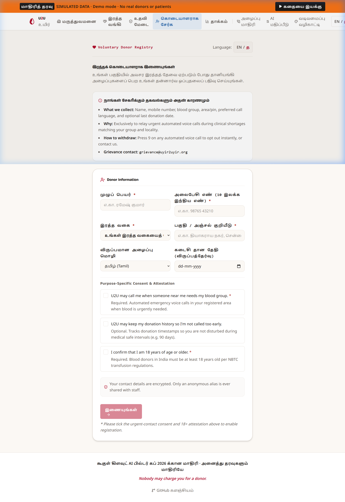

# U2U Privacy, Safety & Clinical Guardrails

> **Status:** planned (Enforced across backend, frontend, and data persistence models)

This document outlines the strict privacy boundaries, data minimization protocols, consent mechanisms, and clinical guardrails governing U2U (Uyir2Uyir).

---

## 1. Regulatory Boundary: Prototype, Not a Medical Device

> [!IMPORTANT]
> **Prototype Declaration:** U2U is an experimental research and coordination software prototype developed for the Google Cloud AI Builder Cup 2026. It is **not** a certified medical device, diagnostic apparatus, or clinical decision support software under the Central Drugs Standard Control Organisation (CDSCO), US FDA, or EU MDR regulations [CITE SOURCE].

- U2U does not diagnose medical conditions, evaluate blood compatibility, analyze clinical laboratory markers, or recommend medical treatments.
- All blood matching logic in the software operates purely as an administrative contact relay based on declared donor blood groups.
- All donor eligibility determinations, hemoglobin screenings, health questionnaires, and physical acceptance or deferral actions are conducted exclusively by licensed, authorized **blood centre staff** following national blood transfusion standards [CITE SOURCE].

---

## 2. Data Minimization: Data Kept vs Data Discarded

U2U adheres to rigorous data minimization principles:

| Category | Kept in Persistence | Discarded Immediately / Never Kept |
|---|---|---|
| **Public Desk Inputs** | Verification decision (`VERIFIED_MATCH`, `SENT_TO_HOSPITAL`, or `NOT_VERIFIED`), extracted entities if valid | **Raw forwarded message text is purged from memory immediately** after extraction. Sender phone numbers, chat logs, and forwarded metadata are never stored. |
| **Patient Information** | Internal hospital reference (`patientRef`), units needed, requested blood component | Patient full legal names, diagnoses, ward/bed locations, medical history, and clinical records are **never collected or stored**. |
| **Donor Information** | System alias (e.g. `"Donor A7"`), declared blood group, area/pin, preferred language (`en`/`ta`), consent timestamps | Raw plaintext phone numbers are kept in encrypted outreach vaults only; never stored alongside names in plaintext. |
| **Voice Records** | Structured call states (`RINGING`, `ON_THE_WAY`, `ACCEPTED`, `DEFERRED`), round number, ETA | Voice audio recordings of donor calls are **never captured or recorded**. |

---

## 3. Donor Anonymity & Masking

1. **Public Anonymity:** Donors are never exposed to families, the public, or other donors. Across all dashboards, event timelines, and APIs, donors are identified strictly by an immutable random alias (e.g., `"Donor A7"`).
2. **Staff Access Controls:** Blood bank and hospital staff dashboards view donors exclusively by alias, declared blood group, and estimated arrival time. Under authorized audit views, staff see at most the last 4 digits of a contact number (`+91 ••••• ••123`).
3. **Patient Reference Protection:** The internal hospital patient identifier (`patientRef`) exists strictly in authenticated hospital and blood centre views. It is omitted from all public endpoints (`GET /requests/{id}/status`), masked in hospital confirmation links (`patientRefMasked`), and excluded from public Firestore rules.

---

## 4. Purpose-Specific Consent & Consent Screen (`/join`)

### Consent Screen

Voluntary blood donor registration requires explicit, granular, purpose-specific consent:

- **Bilingual Interface:** Full support for Tamil (`ta`) and English (`en`) via `LangToggle` at the top right, ensuring donors comprehend all terms in their preferred language.
- **Data Collection & Withdrawal Notice:** A clear, upfront summary informing donors what data is collected (name, phone, blood group, area), why (relaying urgent blood requests), how to withdraw at any time (press 9 on any automated call, or through the web page), and grievance officer contact (`grievance@uyir2uyir.org`).
- **Two Unticked Checkboxes:** On the donor onboarding screen (`/join`), consent checkboxes are strictly unselected by default. Pre-ticked consent boxes are prohibited under privacy regulations:
  1. *Urgent Contact Consent (Mandatory to join):* `"U2U may call me when someone near me needs my blood group."`
  2. *Donation History Consent (Optional):* `"U2U may keep my donation history so I'm not called too early."`
- **Adult Attestation (Mandatory to join):* Mandatory affirmation: `"I confirm that I am 18 years of age or older."`
- **Disabled Join Action:** The `"Join"` button remains completely disabled until both the urgent-contact consent and 18+ attestation checkboxes are explicitly ticked and required fields are valid.
- **Strict Phone Privacy on Confirmation:** Validated as an Indian mobile number, but upon successful submission the phone number is **never displayed back** on the screen. The user receives only their anonymous alias (e.g., `"Donor A7"`) and confirmation that they will only be contacted when matched and eligible.
- **Simulated Demo Notice:** In demo mode, clearly declares: `"Demo: nothing is sent and no call will be made."`

---

## 5. Instant Opt-Out: "Press 9 to Stop Calling"

Donor autonomy and protection from fatigue are core design requirements:

- **Explicit Voice Prompt:** Every automated phone call clearly recites:
  > *"Press 1 if you are on the way. Press 2 if you cannot make it. Press 9 to stop receiving calls from U2U."*
- **Immediate Execution:** Pressing 9 transitions the call state to `OPTED_OUT` and deactivates the donor record in Firestore.
- **Permanent Suppression:** Donors with `OPTED_OUT` status are permanently excluded from all future outreach matching rounds unless they explicitly re-register.

---

## 6. Retention & Data Lifecycles

- **Active Emergency Window:** Blood requests remain active for a maximum expiration window configured by the hospital (typically 2 to 6 hours). Once expired, no further outreach calls are placed.
- **Demo Mode Purge:** In `DATA_MODE=demo`, test databases are ephemeral and can be wiped and re-seeded at any time via `POST /admin/reset`.
- **System Audit Logs:** Cloud Logging preserves pseudonymized transaction traces for system health monitoring, excluding personally identifiable information (PII).

---

## 7. Staff Authority Over Donor Acceptance

To maintain safety and quality standards in blood transfusion services:
- Neither the application nor the AI model can mark a donor as `ACCEPTED` or medically cleared.
- Donors arriving at the blood bank undergo standard physical screening (hemoglobin testing, blood pressure, copper sulfate/screening assay, donor deferral questionnaire) conducted by blood centre professionals.
- Centre staff log the physical decision (`POST /calls/{id}/accept` or `POST /calls/{id}/defer`) directly into the screening portal, guaranteeing that clinical authority remains 100% human-controlled.
