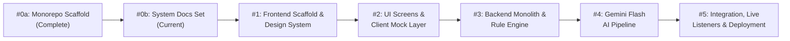

# U2U Implementation Roadmap & Pilot Path

> **Status:** built (Hackathon milestones 0a through 5 complete; clinical pilot pathway planned)

This document outlines the development milestones for the Google Cloud AI Builder Cup 2026 prototype, explicit out-of-scope boundaries, and the long-term clinical pilot pathway.

---

## 1. Explicitly Out of Scope for the Prototype

To maintain ethical safety, prevent clinical harm, and ensure regulatory compliance, the following capabilities are **explicitly out of scope** for this prototype (Section 8 of `U2U_BRIEF.md`):

1. **Real Donors or Patients:** All donor profiles, phone numbers, patient identifiers, and hospital fixtures are strictly simulated.
2. **Automated WhatsApp or SMS Dispatch:** The prototype does not send automated outbound text messages or unsolicited broadcast messages.
3. **Third-Party Telephony Vendors to Real Donors (e.g. Exotel):** Real cellular calls are strictly restricted to verified team allowlists via Twilio for telephony architecture validation. Evaluators and judges test voice calls directly in the browser via `/sim`. Outbound calls to real donors through an Indian telephony provider (e.g., Exotel) are explicitly roadmap.
4. **Live Weather API Feeds:** Emergency weather warnings (e.g. IMD orange alert) operate via an administrative simulation toggle (`POST /admin/settings/weather`), not live meteorological feeds.
5. **CSV Donor Bulk Import:** Bulk uploading of unconsented third-party donor lists is strictly prohibited; only granular self-consented signups (`/join`) are supported.
6. **Automated Medical Eligibility Decisions:** Algorithmic or AI-driven clearance of donor health is prohibited. All eligibility determinations remain with licensed human blood centre personnel.
7. **Medical Advice or Clinical Consultation:** The platform provides communication relay only; no diagnostic or clinical guidance is offered.
8. **Financial Payments or Fees:** U2U processes zero financial transactions. Commercial transactions for blood are illegal under national blood safety laws (Supreme Court of India in *Common Cause v. Union of India*, 1996; *Drugs and Cosmetics Rules, 1945*, Schedule F, Part XII-B).

---

## 2. Development Milestones

### Milestone 0a: Repository Scaffold & Agent Guardrails
- **Status:** Complete (2026-10-13)
- Initialized monorepo skeleton, root `AGENTS.md`, environment templates, and licensing.

### Milestone 0b: Canonical Documentation Set
- **Status:** Complete (2026-10-13)
- Created complete 9-document specification set (`ARCHITECTURE.md`, `API_CONTRACT.md`, `DESIGN_SYSTEM.md`, `FRONTEND.md`, `AI_DESIGN.md`, `PRIVACY_SAFETY.md`, `TESTING.md`, `DEMO.md`, `ROADMAP.md`).

### Milestone 1: Frontend Vite Scaffold & Tailwind v4 Design Tokens
- **Status:** Complete
- Scaffolded React 19 + TypeScript + Vite project in `frontend/`.
- Configured Tailwind CSS v4 variables mapped to warm-paper and crimson design tokens.
- Implemented core accessible UI components with full keyboard and screen reader support.

### Milestone 2: Interactive Role Screens & Client Mock Engine
- **Status:** Complete
- Built all 9 application routes (`/`, `/hospital`, `/centre`, `/desk`, `/confirm/:token`, `/join`, `/sim`, `/impact`, `/eval`).
- Implemented `mockClient.ts` to replicate the $N+1$ counting rule and state machine for offline zero-latency demo evaluation.
- Embedded the mandatory orange `"SIMULATED DATA"` banner across all screens.

### Milestone 3: FastAPI Modular Monolith & Rule Engine
- **Status:** Complete
- Scaffolded Python 3.12 FastAPI backend package structure across all modules.
- Implemented deterministic $N+1$ rule engine, call state machines, and Firestore client adapters.
- Built 162 backend tests verifying state transitions, invariants, and timeout expirations.

### Milestone 4: Gemini Flash Extraction Pipeline on Vertex AI
- **Status:** Complete
- Integrated Vertex AI Gemini Flash (`asia-south1`) with temperature 0 and structured JSON schema output.
- Implemented Python verbatim quote verification and financial remuneration detection.
- Constructed labelled test dataset in `backend/eval/` and implemented `/eval/latest` API endpoint.

### Milestone 5: Full Integration, Live Snapshot Listeners & Cloud Deployment
- **Status:** Complete
- Connected frontend real-time listeners directly to Firestore (`u2u-demo`).
- Deployed FastAPI container to Google Cloud Run and Vite bundle to Firebase Hosting.
- Executed full E2E 6-step demo scenario verification.

---

## 3. The Clinical Pilot Pathway & Outreach Channels (Post-Hackathon)

Following the prototype phase, real-world deployment requires a rigorous clinical, ethical, and legal pilot framework:

1. **Indian Voice Telephony Provider (Exotel) & Basic Phone Support:**
   - Transition to an enterprise Indian telephony vendor (e.g. Exotel) with TRAI-approved virtual CLI routing.
   - **Virtual Number Masking:** Donors and blood centres never see each other's actual personal phone numbers; voice calls connect through ephemeral virtual proxies.
   - **Basic Phone Equality:** Full DTMF keypad fallback (1 = Coming, 2 = Can't, 9 = Stop) ensures consented donors with basic feature phones (e.g. JioBharat, Nokia 105) receive equal emergency access without requiring smartphones or data packs.
2. **Transactional SMS after National DLT Registration:**
   - Pre-registration of transactional SMS templates and principal entity IDs on the Indian telecom Distributed Ledger Technology (DLT) platform (Vilpower/Smartping) under TRAI commercial communication rules.
   - Automated dispatch of instantaneous SMS confirmations upon Press 1 / "I'm coming" containing centre name, Google Maps destination link, and patient emergency token.
3. **Official WhatsApp Business Platform:**
   - Verified green-tick WhatsApp Business API onboarding for participating blood centres.
   - Safe transmission of the "Uyir chain" post-donation message from hospitals: *"Someone gave life to your family today. When you're ready, you can do the same."* with the `/join` link.
   - Interactive quick-reply buttons allowing donors to confirm arrival status.
4. **Push Alerts for Consented Mobile App Users:**
   - Low-latency Firebase Cloud Messaging (FCM) push notifications for registered donors who install the mobile app, providing a silent, urgent visual prompt with one-tap accept before an automated phone call rings.
5. **Institutional Ethics & Clinical Governance:**
   - Formal Institutional Review Board (IRB) review with partner medical institutions and accredited blood centres.
   - Clinical governance committee oversight to validate blood safety protocols (National Blood Transfusion Council / DGHS Transfusion Medicine Standards).
6. **Data Protection & Healthcare Privacy Compliance:**
   - Full compliance with India's Digital Personal Data Protection Act (DPDPA 2023, Ministry of Electronics & IT, Government of India).
   - Exploration of voluntary ABHA (Ayushman Bharat Health Account) integration for voluntary donor health record verification.
7. **Phase 1 Geographic Pilot:**
   - Small-scale pilot limited to 2 accredited charitable blood centres in Chennai, Tamil Nadu, coordinating solely for rare blood group shortages (e.g. O-negative, Bombay blood group) before expanding to general emergency requests.
