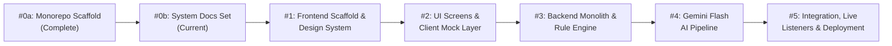

# U2U Implementation Roadmap & Pilot Path

> **Status:** built (Hackathon milestones 0a through 5 complete; clinical pilot pathway planned)

This document outlines the development milestones for the Google Cloud AI Builder Cup 2026 prototype, explicit out-of-scope boundaries, and the long-term clinical pilot pathway.

---

## 1. Explicitly Out of Scope for the Prototype

To maintain ethical safety, prevent clinical harm, and ensure regulatory compliance, the following capabilities are **explicitly out of scope** for this prototype (Section 8 of `U2U_BRIEF.md`):

1. **Real Donors or Patients:** All donor profiles, phone numbers, patient identifiers, and hospital fixtures are strictly simulated.
2. **Automated WhatsApp or SMS Dispatch:** The prototype does not send automated outbound text messages or unsolicited broadcast messages.
3. **Third-Party Telephony Vendors (e.g. Exotel):** Outbound telephony is restricted to Twilio allowlists for team demonstration and in-app simulated audio.
4. **Live Weather API Feeds:** Emergency weather warnings (e.g. IMD orange alert) operate via an administrative simulation toggle (`POST /admin/settings/weather`), not live meteorological feeds.
5. **CSV Donor Bulk Import:** Bulk uploading of unconsented third-party donor lists is strictly prohibited; only granular self-consented signups (`/join`) are supported.
6. **Automated Medical Eligibility Decisions:** Algorithmic or AI-driven clearance of donor health is prohibited. All eligibility determinations remain with licensed human blood centre personnel.
7. **Medical Advice or Clinical Consultation:** The platform provides communication relay only; no diagnostic or clinical guidance is offered.
8. **Financial Payments or Fees:** U2U processes zero financial transactions. Commercial transactions for blood are illegal under national blood safety laws [CITE SOURCE].

---

## 2. Development Milestones

### Milestone 0a: Repository Scaffold & Agent Guardrails
- **Status:** Complete (2026-10-13)
- Initialized monorepo skeleton, root `AGENTS.md`, environment templates, and licensing.

### Milestone 0b: Canonical Documentation Set
- **Status:** Complete (2026-10-13)
- Created complete 9-document specification set (`ARCHITECTURE.md`, `API_CONTRACT.md`, `DESIGN_SYSTEM.md`, `FRONTEND.md`, `AI_DESIGN.md`, `PRIVACY_SAFETY.md`, `TESTING.md`, `DEMO.md`, `ROADMAP.md`).

### Milestone 1: Frontend Vite Scaffold & Tailwind v4 Design Tokens
- **Status:** Complete
- Scaffolded React 19 + TypeScript + Vite project in `frontend/`.
- Configured Tailwind CSS v4 variables mapped to warm-paper and crimson design tokens.
- Implemented core accessible UI components with full keyboard and screen reader support.

### Milestone 2: Interactive Role Screens & Client Mock Engine
- **Status:** Complete
- Built all 9 application routes (`/`, `/hospital`, `/centre`, `/desk`, `/confirm/:token`, `/join`, `/sim`, `/impact`, `/eval`).
- Implemented `mockClient.ts` to replicate the $N+1$ counting rule and state machine for offline zero-latency demo evaluation.
- Embedded the mandatory orange `"SIMULATED DATA"` banner across all screens.

### Milestone 3: FastAPI Modular Monolith & Rule Engine
- **Status:** Complete
- Scaffolded Python 3.12 FastAPI backend package structure across all modules.
- Implemented deterministic $N+1$ rule engine, call state machines, and Firestore client adapters.
- Built 125 backend tests verifying state transitions, invariants, and timeout expirations.

### Milestone 4: Gemini Flash Extraction Pipeline on Vertex AI
- **Status:** Complete
- Integrated Vertex AI Gemini Flash (`asia-south1`) with temperature 0 and structured JSON schema output.
- Implemented Python verbatim quote verification and financial remuneration detection.
- Constructed labelled test dataset in `backend/eval/` and implemented `/eval/latest` API endpoint.

### Milestone 5: Full Integration, Live Snapshot Listeners & Cloud Deployment
- **Status:** Complete
- Connected frontend real-time listeners directly to Firestore (`u2u-demo`).
- Deployed FastAPI container to Google Cloud Run and Vite bundle to Firebase Hosting.
- Executed full E2E 6-step demo scenario verification.

---

## 3. The Clinical Pilot Pathway (Post-Hackathon)

Following the prototype phase, real-world deployment requires a rigorous clinical, ethical, and legal pilot framework:

1. **Institutional Ethics & Clinical Governance:**
   - Formal Institutional Review Board (IRB) review with partner medical institutions and accredited blood centres.
   - Clinical governance committee oversight to validate blood safety protocols [CITE SOURCE].
2. **Official WhatsApp Business Platform Onboarding:**
   - Onboarding via the verified WhatsApp Business API (green tick verification) to establish trusted institution identity for blood centre communications.
3. **Telecommunication Regulatory Compliance (India):**
   - Registration with TRAI (Telecom Regulatory Authority of India) under the 140-series commercial communication regulations for automated voice broadcasts [CITE SOURCE].
   - National Do Not Call (NDNC) registry compliance and explicit opt-in cryptographic verification.
4. **Data Protection & Healthcare Privacy:**
   - Compliance with India's Digital Personal Data Protection Act (DPDPA) [CITE SOURCE].
   - Exploration of voluntary ABHA (Ayushman Bharat Health Account) integration for voluntary donor health record verification.
5. **Phase 1 Geographic Pilot:**
   - Small-scale pilot limited to 2 accredited charitable blood centres in Chennai, Tamil Nadu, coordinating solely for rare blood group shortages (e.g. O-negative, Bombay blood group) before expanding to general emergency requests.
